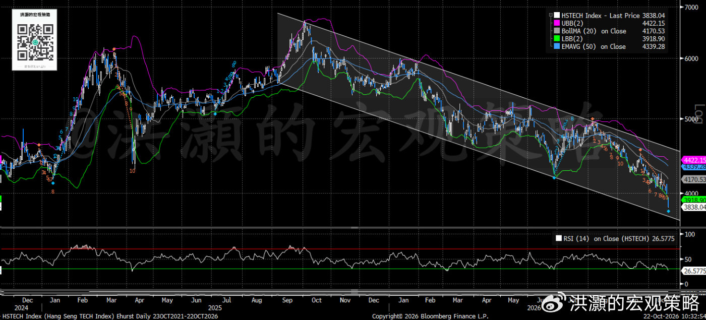
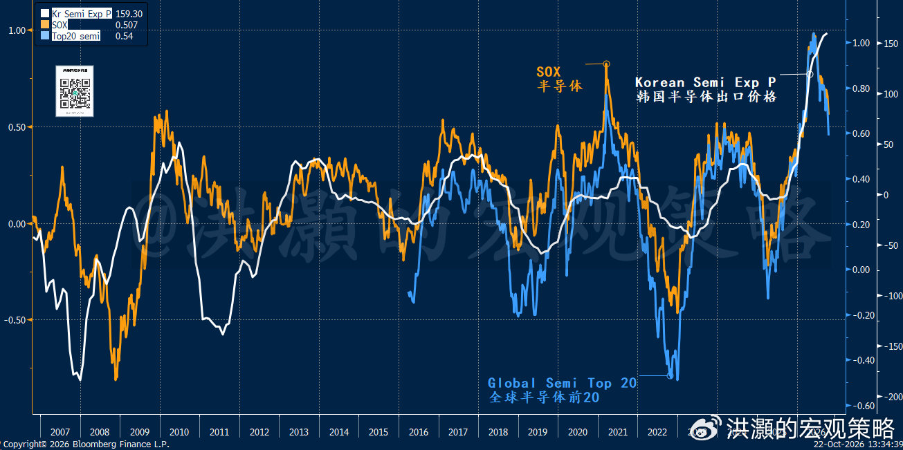
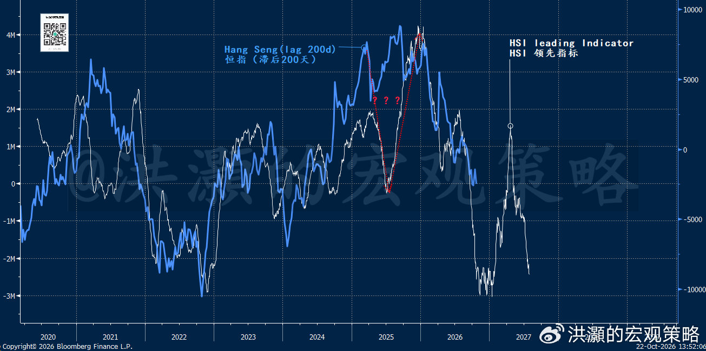

# 洪灝：如何看待最近的“无差别拋售潮”

> 作者：洪灝  
> 来源：微博「洪灝的宏观策略」  
> 发布日期：2026-10-22 18:12  
> 原帖：https://weibo.com/ttarticle/p/show?id=2309405356883266895984  
> 导语：否极则泰来。

今天，香港市场出现了一次统计意义上高度显著的单日下跌。恒生指数盘中跌近3%，相对一年期日收益率分布超过了-3倍标准差；恒生国企指数跌超过了3%，近3倍的标准差。作为对比，内地的市场虽然也同步下跌，但是在有形之手的护盘之下，抛售潮的冲击集中在港股上市的网络与科技权重股之上，而并非整个经济的基本面。

恒科盘中最大跌幅达5.2%，收盘跌了近5%，约-3倍的标准差。这个单天的表现，在过去三年所有的交易日中名列倒数第五。据公开新闻报道，电商平台被召集并要求加强产品质量标准，因此大型互联网平台公司首当其冲。于此同时，全球半导体与AI相关股票继续出现获利了结的行情，把昨晚科技七雄之一的公司的AI资本开支指引上调、以及一家最大的AI芯片公司的供应商远超预期的业绩对于市场疑虑的安抚一冲而散，美股科技财报后的表现在盘前也回吐了。

沪深300已从六月高点回落约20%，逼近了所谓的技术性熊市的门槛。而近日经济数据超预期，尤其是增长和出口，这些超预期的数据令市场对于政策刺激的预期进一步降温。当然，我们在上周的电视采访和播客中就表示，在市场下行的最后阶段，下行的压力往往会加速，这也是投资者最容易感情用事、最无法抵抗压力而“割肉”的阶段。同时，我们在采访中还表示，市场对于政策刺激的预期不宜过分，而如果市场下行压力过大的话，那么对于市场更直接的政策出现的概率反而会更大。这些观点，我们在行星上与读者反复强调。这几天，在岸市场的下午盘宽基指数ETF的大额申购，“有形之手”的踪影若隐若现。

放在更长的时间框架里看，这次港股的下跌属于“显著但非极端”的类尾部事件。过去三年恒生科技有18个交易日的方差是低于-2，约占全部交易日的2%，频率略高于正态分布的预期，说明了这轮下跌的确是类似于尾部但非极端事件。今天近3σ的单天下行，与2024年底至2025年初那波-2.5σ至-3.0σ的下行趋势一致。当时，市场由于量化基金过于拥挤的策略引发了一轮由于宏观数据不及预期而导致的抛售潮。俗称量化崩盘。尽管如此，今天恒科的下跌远低于2025年4月特朗普“解放日”关税冲击导致的近10σ和2024年10月国庆后反转的逾7σ的暴跌。那两次是离散的宏观系统性冲击（idiosyncratic macro crash），与今天的行情不尽相同。

这些历史类比的案例发生后市场运行的路径也形态各异。恒科八次RSI相对强弱指数跌至26或以下的先例中，2024年1月17日那次（-2.86σ，监管与增长担忧驱动）在幅度和驱动因子上与今天的盘面最为接近。那时，恒科在随后约10个交易日继续走弱，之后才展开持续反弹，到了第37个交易日反弹的幅度达到了+15.3%，到了第60个交易日反弹则回落至6%左右，但依然为正收益。当然，历史并不简单重复，但是市场价格过度的反映情绪而非基本面事实往往给交易员创造交易性机会。

至于2025年4月特朗普解放日之后的V型反弹，那时5个交易日即反弹了+14%，因为特朗普TACO；2022年10月底的反弹，也就是我们发表的那篇著名的《洪灝：买！买！买！》的报告的翌日起的40个交易日内，指数反弹了+47%，显然是因为政策转向发出的明确信号而致。而2022年9月30日和今天这类“磨底型”下跌，如果缺乏明确的政策信号，RSI在低位徘徊却缺乏催化剂，那么反弹的力度显然将不及上述的这两次。今天，期权市场上指数大型成分股的看跌期权成交量达到20日均值的2至3倍，说明对冲需求集中释放，也说明市场的情绪逐步运行到了冰点。

那么，市场何时才可以真正的见底，并展开一波反弹。我们检验了几个指标。

首先，我们看到恒科经历了最近的一轮抛压之后，已经运行到了下行趋势的底部区域（图一）。同时，从价格结构来看，拋售的波浪已经开始进入了尾声阶段（wave count），而恒科今天的蜡烛也跌穿了布林线的下轨。由此可见，我们把今天的盘面称之为过去三年最严重的抛压之一毫不为过，并与开篇的统计数据相呼应。

**图一：恒科的拋售压力进入尾部。**

我们还可以看到，韩国半导体的出口价格还在继续的攀升。一般来说，价格的上涨显示需求依然大于供给，而最大的AI芯片公司未来18个月的产能已经被订购一空。由此，我们很难得出确切的结论，称AI半导体的需求强势不可持续（图二）。尽管如此，我们追踪的半导体周期继续从高位下行。

这个现象我们在六月中旬发下半年展望报告的时候，已经为读者预警过了，也是我们预测半导体泡沫在下半年破灭的重要论据之一。如今，半导体泡沫如期崩裂，我们试图在这次下行的轨迹中继续能够在更短的时间窗口里寻找交易性机会。在如此动荡的市场里，我们在试图成就这种看似几乎不可能的功业。我们的职业素养呼唤着我们的努力，毕竟，还是有很多散户投资者套在了六月中的半导体泡沫高位之上。

**图二：韩国半导体出口价格继续上升，显示半导体需求大于供给。**

最后，我们的港股领先指标显示筑底的时间窗口理论上将出现在11月中前、12月中和明年的一月中（图三）。当然，这种统计数据模型并非万无一失的。但是参考当下的市况和市场叙事，这些模型预测的时间节点将成为交易员重要的观察窗口。

**图三：港股的领先指标。**

总结一下：港股，尤其是恒科最近的抛售潮是统计意义上非常显著的小概率尾部事件，其发生的概率大约在1%左右。也就是说，一年里大约只能看到一两个这样的盘面。尾部极端事件的概率小，预示着市场情绪的宣泄通过抛售潮反映。这个时候资金的夺路出逃与基本面无关，与情绪和资金面的变化密切相关。

恒科的技术面已经严重超卖，任何一个小的正面的消息，甚至是任何消息，都可以成为短期反弹的借口。随着11月的临近，技术筑底反弹的时间窗口将逐步打开。当然，如我们在上一篇报告《洪灝：可以抄底了吗？》里指出的，现在依然是左侧交易。而左侧的波动尤其大。而我们描绘的是价格运行的路径和趋势，至于如何把握，那么则是每个交易员见仁见智的问题。

祝交易有所斩获。

洪灝  
2026.10.22

