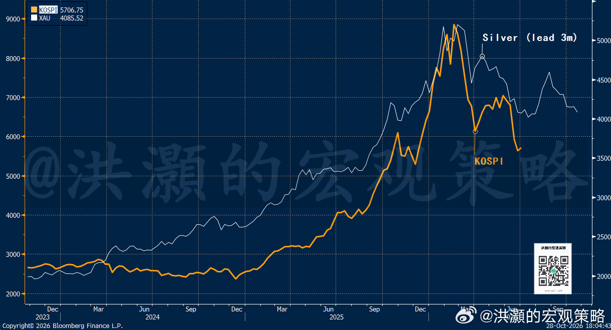
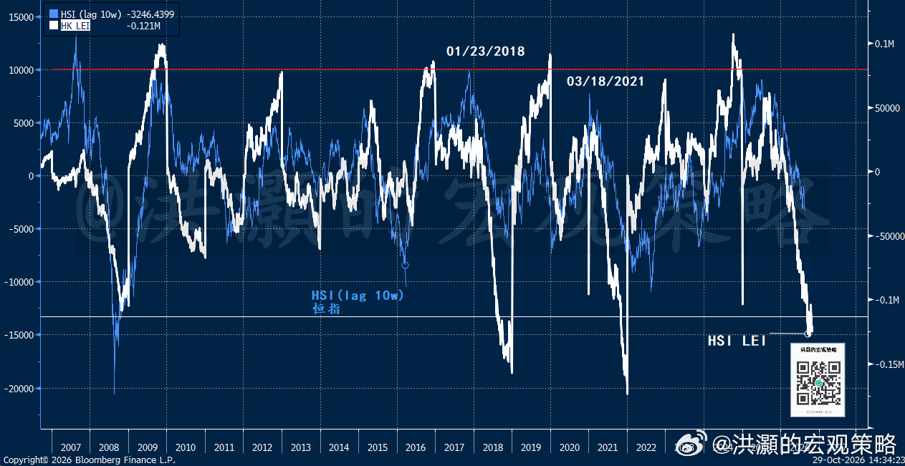
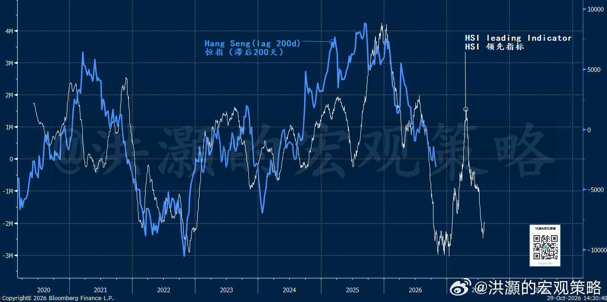

# 洪灝：谁在拋售港股

> 作者：洪灝  
> 来源：微博「洪灝的宏观策略」  
> 发布日期：2026-10-30 08:25（中国香港）  
> 原帖：https://weibo.com/7799274131/Rp1mYbvIY

过去一个月，恒生指数从九月末约24,600点滑落至今日早间的约23,000点左右，跌幅约6%。十月二十二日，离岸信托税款申报窗口关闭之日，恒指下挫3%、一度跌破23,000点，恒生科技指数更跌去5%。

图一：白银泡沫领先韩股约三个月。

市场讨论了很多可能性。富豪卖股缴税，离岸交易账户的交易规则改变等假说层出不穷。每个说法都似乎几分道理，然而无一能经得起推敲。我们逐只查阅了港交所股票托管记录，发现答案并非共识所想，却更为深远。

的确，市场压力是真实存在的，非常集中且一边倒，看一下个股的AH溢价变化情况。一家大型人寿公司的A股在八月和九月相对H股的溢价在73%至87%之间。十月上半月，差距扩大至84%至95%；十月十六日突破100%，十月二十六日更攀至108.4%的峰值。也就是在这一天，两地市场出现深V。

然而，同一家保险公司，同样的资产负债表，同样的保单持有人，如今在香港的价格仅为上海的一半左右。一家大型的芯片公司的股价则更为极端。其溢价在今年夏季介于134%至163%之间，十月初维持在158%附近，十月二十一日达到177%，随后在十月二十六日飙升至210%。出口管制与AI硬件交易的退潮，足以解释这家公司的股价为何下跌，却解释不了何以同一家公司在在岸市场的价格是离岸市场的两倍。

资金流向也在叙述同样的故事。内地投资者已通过港股通连续11个交易日净卖出港股，合计约304亿港元，其中十月二十二日单日就流出约92亿港元。仅上周，南向资金流出即达170亿港元，为七月末以来之最。而在此之前，内地资金的支撑已然消退：前九个月南向净买入合计仅约4,400亿港元，而2025年约为1.4万亿港元。曾在2025年托举香港的边际买家，如今却变成了边际卖家。

然而，中国经济依然呈现韧性。三季度GDP增长4.5%，超出市场预期。九月工业增加值增速加快至5.5%，为全年最佳。出口同比激增36%，前九个月贸易顺差接近9,380亿美元。九月工业企业利润增速从八月的4.2%跃升至14.4%，财新制造业PMI升至52.1。

诚然，这是一个双速经济：九月社会消费品零售总额仅增长1.1%，五月更曾录得负增长，广义财政支出已连续七个月减弱。但一个出口引擎轰鸣、工厂利润回暖的经济体，与市场指数下行的趋势分道扬镳、严重背离。当价格与基本面如此急剧背离，问题不在于经济的表现如何，而在于谁必须卖出，以及为什么。

市场对于富豪减持的说法是部分正确的，但存在明显的谬误。离岸信托收入征收20%的税的90天窗口于十月二十二日关闭。我们对于港交所托管记录的调查证实，一些家族确实卖出了部分持仓。比如，一家火锅公司的持有创始人信托的瑞银托管仓位自七月以来减少了已发行股份的5.2%，约2.88亿股、约30亿港元。其中大部分发生在九月的大宗交易中，十月又有0.3%流出；一家玩具公司1.9%的股份在截止日当周存入香港中央结算系统，与公告显示的其控股股东十月二十二日出售的1.56%大宗交易相吻合；一家招聘公司的创始人减持了约8.63亿港元。另外，一家制药的创始人持有的一亿股票、价值约33亿港元、占公司1.65%的股份于十月二十一日至二十八日间存入摩根士丹利。尽管尚未申报，这是大宗交易或股份质押的经典前奏。一家奶茶连锁店的创始人持股在锁定期届满后移入中央结算系统，不过家族仍持有76%。

然而，有两个事实显示了这些抛售的局限性。其一是规模。可识别的创始人抛售两个月合计约60亿至70亿港元，即便上述制药公司存入的股份被悉数出售，总额仍不及南向投资者11天内卖出量的一半。其二，在每一个家族减持的创始人股票中，内地资金都是买入的对手盘。南向投资者自七月以来增持了上述火锅公司1.75%、上述玩具公司3.94%、一家民营地产公司1.25%，而这家地产公司的创始家族通过汇丰减持了约2%。

在其他公司方面，家族并没有卖出。一个体操明星家族在九月初买入约1亿股，持股比例从16%升至20%。一家国际物流公司、大米和始祖鸟公司的信托托管仓位纹丝未动。著名潮玩公司的创始人41%股份的瑞银托管仓位仅变动了已发行股份的0.11%，而该股一个月内下跌了近19%。在23只股票中，私人银行参与者的持仓几乎没有变化。家族的确有减持，但它并非是一个普遍现象。

牛牛账户的假说则在时间点上站不住脚。自五月二十二日整顿以来，离岸券商的内地客户只能卖出，这的确是一个单向阀门。但内地账户仅占牛牛有资产账户的约13%、客户总资产的17%。数据显示，由此产生的资金流出占客户资产的中个位数百分比，分布于内地与香港客户之间，集中在六月和七月，到八月已趋缓——而那个季度恒指上涨了约6.5%。

新股供给也不太可能是下行压力的触发因素，尽管供给确实沉重：前九个月116家公司上市，募资额创纪录的3,880亿港元，另有逾600家申请者排队等候。然而，这些供给全年都在涌入，市场上涨时也不例外。因此，从时间上看，新股发行并非是这次压力行情的催化剂。

那么，究竟是谁在抛售？

两组力量尤为突出，而且节奏同步。第一组是对冲基金。经纪商的持仓数据显示，对冲基金已将对人工智能硬件的持仓平回年初水平，而港股的空头头寸接近历史高位，且在科技硬件板块仍在上升。韩国投资者曾是人工智能主题默默的买家，但今年以来却已卖出约8.41亿美元的中国内地和香港股票。相比之下，海外长线基金坚守阵地，持仓仍高于历史常态。这是杠杆化、战术性的短期资金在撤离，而非所有机构的缴枪投降。

规模更大的是内地机构。沪深300在十月下旬进入技术性熊市，较六月峰值低20%，抹去约2.4万亿美元市值。A股融资余额已跌破年初水平。内地市场下跌意味着公募基金、保险资金权益账户和理财产品面临赎回压力，也意味着任何以股票质押借款者被迫去杠杆。必须筹集现金的基金补孖展。

此时，两个市场之间的不对称便具有决定性。在上海和深圳，有形之手正在买入。宽基指数ETF上周吸引约1,287亿元，为2025年四月以来最大单周流入。利用这股买盘接盘的时机卖出A股并非不可能，但每位基金经理都知道管理层希望指数往哪个方向走，不能忤逆而行。

但香港却没有这样的后盾。H股流动性好、已然便宜，卖出它不会引来不必要的关注。于是，应对赎回的现金在香港筹集，而A股由有形之手买盘托住。这正是AH溢价加速扩大的原因之一。

这个过程存在着一个反身性回环。随着H股比其A股跌得更快，内地基金香港持仓的书面未实现亏损扩大，其报告回报落后很有可能使投资者赎回前看不到实际价格，导致香港基金产品的赎回加速。这又迫使它们进一步卖出那些本就跌得最快的持仓。

与此同时，做空同一批科技股的对冲基金有充分动机加码施压。因此，AH溢价扩大不仅是抛售的症状，在一段时间内也是其原因。这类负循环很难因为估值变得非常荒谬而终结，它们只能终结于被迫平仓的交易员卖无可卖为止。当然，短期基金也会选择性变现：从流动性最好、最拥挤的大盘持仓中筹集现金，同时仍在扫货家族留在桌上的便宜股票。

赎回与去杠杆是流动性事件。它们将随赎回结束而结束，而赎回随内地市场止跌而结束。有形之手的买入集中于A股ETF，因此短期内在岸一端独获支撑，却反而扩大AH溢价。但通过稳定沪深300，它们阻断了最初迫使内地基金卖出港股应对赎回压力的循环。

如今，有形之手的买入已经到了最近三年最高之一，体量与今年六月半导体泡沫破灭时的托盘一致，而政策组合也在转向。在财政支出连续七个月下降之后，预计将在十一月和十二月净发行2.2万亿元债券，为有记录以来同期第二大规模，各省还可能动用另外5,500亿元未使用额度。十二月七日，恒生科技指数将从30只成分股扩大至50只，迫使基准基金买入新增成分股。一旦内地基金不再需要现金应对赎回压力，那些高昂的AH溢价便不再是卖出的理由，而成为宽到无法忽视的套利机会。

我们也必须进一步讨论潜在的风险。海外长线基金尚未卖出；若它们跟随对冲基金，那将是下一轮下跌，而风险敞口最大的股票正是机构持仓最重者，如一系列权重股。随着税务局完成核定，更多创始人大宗交易股份可能接踵而至，那个制药公司和茶品连锁店已然就位，而新股排队仍然漫长。美联储若有意过度收紧，那么也将拖累所有风险资产。

那么，交易员应当关注什么？我们认为，四个信号比任何头条都重要。第一是南向资金连续流向：若连续数个交易日转为净买入，便说明赎回潮正在见顶。第二是AH溢价本身，尤其是那些溢价明显极端化的公司；当沪深300企稳而溢价停止扩大，便很可能意味着被迫卖出者已然完成。第三是香港的托管登记显示着下一轮家族供给是否继续。第四是机构持仓：若海外长线基金开始减持，而对冲基金重建空头，抛售便将进入更危险的阶段。若前两项改善而后两项稳定，底部形成的理由便比较充分了。

历史上也不乏这类被迫抛售潮（forced selling）。2016年初，A股崩盘及随之而来的赎回潮之后，恒指在二月跌至约18,300点；两年内上涨约70%。2022年十月，在中国科技股投降式抛售（capitulation）和极端AH折价之中，恒指在14,600点附近见底，三个月内反弹约一半。2024年一月，在南向与外资长期基金持续卖出之后，恒指跌破15,000点。那时，有形之手开始买入ETF，到五月科指已回升超过30%。这些抛售潮的终结并非是利空出尽，而是被迫抛售枯竭，同时估值与H股折价达到耐心资本无法再忽视的极端。

图二：港股短期和长期指标都接近或已经达到了底部。

总结一下：这场抛售潮以全球半导体泡沫继续崩裂、西方政府国债收益率飙升、伊朗战事悬而未决以及美国中期选举为背景。然而，我们的数据调查显示，虽然富豪家族卖股缴税的压力存在，但并非抛售的主力。香港中央结算系统的托管数据显示，可辨识的持有人两个月抛售了60—70亿港币的股票。而南向最近两周的抛售是这个数字的两倍有余。

同时，数据显示牛牛账户的托管金额并未发生明显变化，虽然约10%+的牛牛账户被限制买入、只能卖出。长期基金的持仓也没有发生明显的变化，公司高管也基本没有卖出。毕竟，谁愿意在市场暴跌、估值压抑的时候卖出？除了那些不得不卖的、被迫抛售港股以应对基金赎回压力的内地基金。这些在关键时刻拿不住仓位的，都是市场的弱手。当然，我们也知道，在一个非理性的市场里进行理性的讨论，尤其是交易还暂时徘徊在左侧的时刻，往往有一种瓦釜雷鸣、黄钟毁弃的感觉。

历史上每次出现类似的强平行情，有形之手都会入市干预，并最终胜利。这就是典型的市场失效（market failure）的时刻。这个时候所有的筹码都带着刚刚割肉之后的鲜血，而有形之手对于快速陨落的股价并不敏感，因为它的持仓时间周期可以很长。

中国经济在出口强势的背景下在三季度显示出韧性，今年实现增长目标基本没有悬念。因此，我们此前也强调，市场不应该对于今年政策刺激有过多的期望，而工作重心将更以市场稳定为主。中国经济结构出现明显的二元化，工业企业利润增长加速，同比增长约15%。这些都是分析师在为市场定价的时候应该关注和分析的。可惜的是，经济学家们都在忙着直播，始终坚持做严肃数据分析和市场预测的人越来越少了。

风雨如晦，鸡鸣不已。

洪灝  
2026.10.30

## 配图

## 图片文字转录

- [image_1_OCR.md](./image_1_OCR.md)
- [image_2_OCR.md](./image_2_OCR.md)
- [image_3_OCR.md](./image_3_OCR.md)
