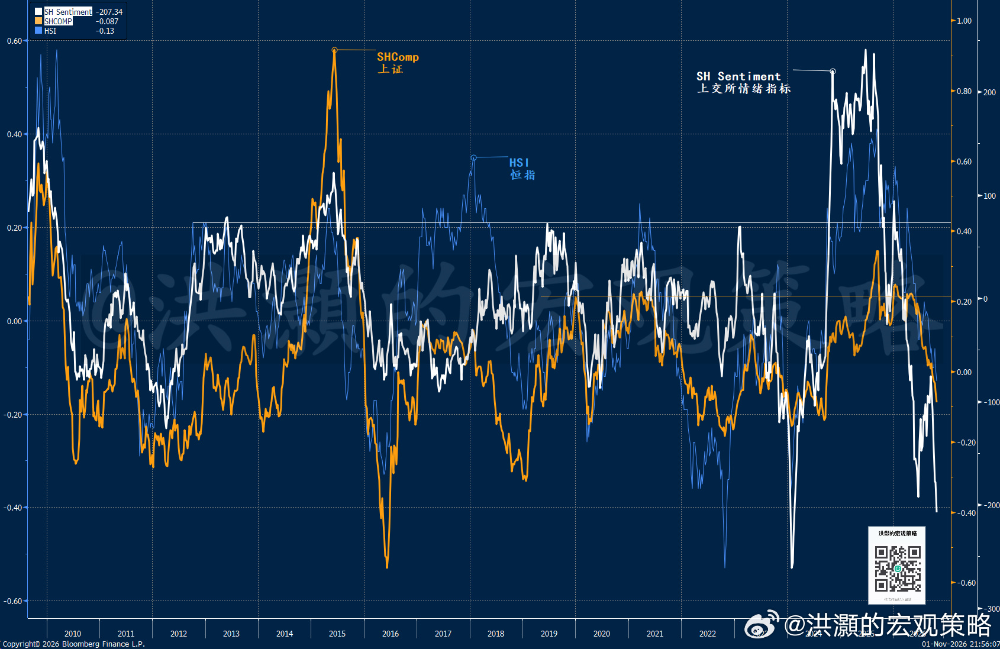
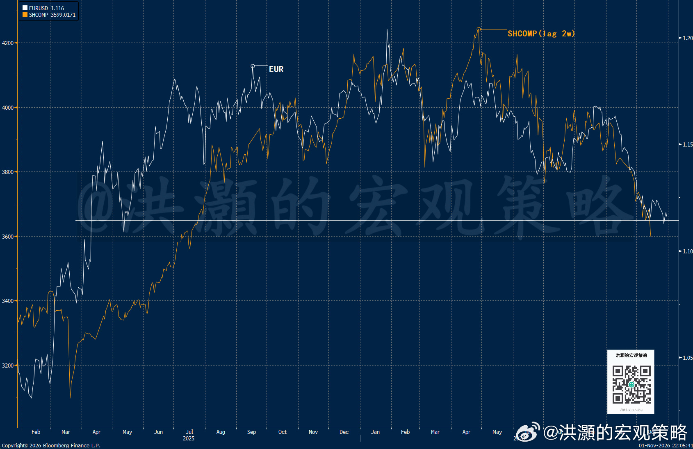

# 洪灝：再见 9.24

> **作者**：洪灝  
> **来源**：微博 V+ 长文  
> **发布日期**：2026-11-02（文末署期 2026-11-01）  
> **原帖**：https://weibo.com/7799274131/Rptb50U3l

2024 年 9 月 24 日下午，三部门联席发布了一套协同发力的政策组合，以支持市场和经济的运行。那时宣布的政策工具，包括 3000 亿元人民币、利率 1.75% 的再贷款工具，用于支持上市公司及其主要股东回购和增持；还有 5000 亿元互换便利，让券商、基金和保险公司把手中的持仓置换成为流动性，用以加仓。当时最令市场激动不已的，是央妈明确表示，这些工具的额度都可以视情况而定大幅增加。同时，会议还包含了降准、房贷纾困，以及为银行补充资本金等讨论。

两年前的那天，沪深 300 当日上涨了 4.3%，随后继续走高。到了 10 月 8 日黄金周后的第一个交易日，沪深 300 已较 9 月中旬的低点上涨了 35%。如果按照历史周回报的标准差来衡量，那一周的涨幅为 2002 年以来最大的单周涨幅。从此，那波行情被载入史册，成为了市场参与者至今依然津津乐道的、当下又翘首以待的“9.24”行情。

今晚，媒体广泛公开报道了明天周一这三家权威机构将再次开会的重磅消息。这次重要会议还将有主要的大型银行参与。周一的会议将讨论如何优化两年前创设的再贷款计划。据报道，一些券商和基金公司已被告知参与此次会议。由于两年前的 9.24 行情依然萦绕人心，因此在这条重磅新闻见报之后，各大微信聊天群都不免浮想联翩，并开始讨论两年前的那个秋天的童话是否将在明天重新上演。

那么，市场参与者应该如何比较明天的这次会议和两年前的那次重若千钧、足以彪炳史册的会议？两年前的 9.24 行情的起点，是当时市场的投降式抛售潮（capitulation）。当时，沪深 300 已较 2024 年 5 月的高点下跌超过 13%，逼近五年低点。9 月 13 日，沪深的远期市盈率为 10.4 倍。上市公司盈利增长疲弱，房地产市场持续低迷，而一家最大的外资机构那时也下调了对中国股票“超配”的评级，国际投资者低配中国市场，甚至还在加空。

然而，就在当时的哀鸿遍野之中，市场迎来了一项实实在在的增量政策。三大部门第一次用央行资产负债表给股市做出承诺。那一周市场重新定价的，不仅仅是一项简单的流动性工具，而是决策者对于市场的关注和抉择。那些曾以为决策者会无限容忍市场下跌的投资者，突然被迫空头回补。而在当时那个流动性稀薄、对于中国市场严重低配的市场里，空头被迫回补制造出了我们当时目睹的、令人耳晕目眩的轧空行情。当下，海外的大型中概股的空单也到达了历史最高。

然而，当时极度火爆的行情在大约一个交易周里就匆匆消退了。那时的交易教训对于周一乃至下周的交易都至关重要。2024 年 10 月 9 日，沪深 300 指数单日暴跌了 7%，随后回吐了前两周的绝大部分涨幅。事实上，当时的再贷款和互换便利等流动性工具的使用量远低于有关部门承诺的水平。据公开数据统计，到了 2024 年 10 月下旬，仅约二十多家上市公司提取了约 110 亿至 120 亿元来进行股票回购或者增持，体量仅占 3000 亿元再贷款额度的一小部分。即便是所有流动性工具全部用足，两项工具合计也远不足那时沪深两市总市值的 1%。

最重要的是，那轮交易性反弹缺乏盈利支撑。2024 年 9 月初，沪深 300 远期每股收益一致预期为 352 元，10 月底却降到了 347 元。分析师没有因刺激政策上调利润预期。因此，当时沪深 35% 的涨幅全部来自估值扩张，而远期市盈率在不到三周内从 10.4 倍拉升到了 14.1 倍。当反弹纯粹依赖于估值倍数的扩张，那么其持续性也取决于投资者情绪的高涨可以维持多久。当时在央行拍板之后，其它各大部门也纷纷进行了后续新闻发布会，但是更多刺激政策的落地远逊于那时市场共识的预期，估值倍数瞬间回落。

简单地说，政策刺激可以猛烈推动估值暂时上升，然而如果刺激不能改变盈利增长轨迹，那么最终由估值提升而产生的牛市将因盈利的下滑而终结。对于流动性工具来说，官宣的流动性数字固然重要，因为这个数字将启动市场上升的触发点，但是流动性工具实际使用的额度才是市场行情得以持续的燃料，也是市场信心的象征。本周一的会议将包括银行和其它金融机构，可能是因为决策者希望能够缩短资金进入市场的时间，并有可能把融资的条件放宽、范围扩大。然而，其效果仍有待考证。

当下市场的情况与两年前有诸多相似之处，但也有重要的区别。沪深 300 周五再次大幅杀跌，收于 3,986 点。10 月单月就下跌 7.3%，是 2024 年十月以来最差的单月表现，而今年年内更是下跌了 13.7%。上证综指年初至今下跌 8.6%，恒生指数下跌 9.1%。上证已经基本上回吐了 9.24 以来的全部涨幅。因此，两次会议前市场的情绪都是空前低迷的，但是按照我们独有的市场情绪指标来衡量，现在市场的情绪比两年前略高一些。现在市场的远期市盈率 11.6 倍，与 9.24 行情之前的估值也基本持平，但今年六月的时候还是在 15 倍出头。也就是说，六月以来在岸市场经历了一次非常凌厉的估值降级（de-rating），远期估值在短短不到四个月里下降了 25%。

**图一：市场情绪处于极度风险厌恶，类似于 9.24 前夕。**

如果要重演 2024 年的估值重估，那么远期市盈率要从约 11.6 倍到 14 倍，在盈利不变的情况下，指数需要上涨约 20%。或者盈利预期必须转向。然而，过去一年每股盈利的预期其实一直在下调，但是分析师对于明年 2027 年的盈利预测却没有太显著的变化。一般来说，卖方往往在年底前或者在明年头两个月获得了 2026 年全年的盈利情况之后，对于 2027 年的盈利进行调整。目前来看，卖方对于明年的盈利情况很可能是过于乐观了，但由于模型数据有限性而尚未对于明年的盈利预测下调。如是，如果这次会议不能马上带来像两年前那样的估值倍数扩张，而盈利很可能在未来数月开始进一步下调，那时市场将进入最后的“杀盈利”行情。如是，我们很难马上做出结论，这次会议或将带来的正面影响可持续多久。

当下的外部环境也远不如当时宽容了。2024 年 9 月，全球利率周期正朝有利于中国的方向倾斜。那时，美联储刚刚开始降息，而现在的市场计入美联储很可能将在 12 月再次加息。周五美国的 10 月非农预计将从疲弱的 29,000 反弹至 65,000，失业率维持在 4.2%。若经济数据强劲，美联储将不得不继续紧缩。上周，央行下调了隔夜逆回购利率 15 个基点到 1.25%。简单地说，央行通过市场化的回购机制已经开始降低市场的融资成本，虽然只有微弱的 15 个基点。显然，这个市场资金成本的边际变化很难提振市场情绪，甚至很可能使资金继续轮动到避险资产，比如长端国债。

美国科技板块近日也出现了大幅波动。上周五，英特尔业绩指引令人失望、股价下跌超过 28% 后，半导体股票单日市值蒸发约 1 万亿美元。那是英特尔有史以来最大的一次单天暴跌。纳指 100 全周下跌超过 2%，进入了技术性回调区间。铠侠警告称，AI 驱动的闪存价格上涨正在停滞，这表明 AI 交易硬件端的边际买家开始饱和了，而亚洲正处于这条供应链的核心。韩国和中国台湾市场直接受到了冲击，而香港和 A 股科技端在情绪上附和。周一的会议很可能很难暂时改变这种全球性的趋势。

周二的中期选举，市场认为众议院已经是民主党的囊中之物，而参议院也并非遥不可及。如果民主党横扫两院，那么它的政策可能会对 AI 行业和数据中心建设带来更严厉的审视，而这恰恰是当前市场承压的主题。共和党继续掌控则提供政策的连续性，可以说会让韩国和中国台湾芯片制造商及其供应商松一口气。民调和赌市在几个关键州参议院选情上存在分歧，因此缺乏交易确定性。其实，历史上就没有在位党不失去一个议会的先例。这种交替是西方制度的结果。当然，特朗普还是可以继续使用行政命令执行他的政策目标，但这些政策的可持续性显然将是一种担忧。

总结一下，本周一的会议是重要的，显示了决策层对于市场稳定性的重视。这次会议与两年前的 9.24 行情有诸多相似之处和不同的地方。两次会议都发生在市场岌岌可危、摇摇欲坠、情绪极度低迷的时候。两次的市场都经历了一次大规模的抛售潮，导致市场估值下降到了历史低点。同时，两次市场对于中国资产都是严重低配，甚至大幅沽空的。这种极度悲观的情绪和压抑的估值是酝酿大级别技术反弹的重要因素。空头回补的轧空行情成就了彪炳史册的“9.24 行情”。

然而，“9.24 行情”只是一次估值快速扩张的上涨，随后由于盈利没有匹配而快速消退。而当下市场的远期估值从六月以来被大幅向下重估，分析师对于明年的盈利预期也过于乐观，但是因为四季度盈利数据还没有公布，因此还未下调。因此，这次对于现有流动性工具的再讨论和再部署对于估值很可能很难有当年的效果，而盈利也很可能很难支持行情的持续。因此，虽然这次会议似乎是一场及时雨，但也很可能只是一场太阳雨。但是我们也衷心希望这次会议只是一系列市场稳定政策出台的第一步。

海外市场的情况也不容乐观。美联储紧缩的偏向很可能还将持续一段时间，这与 2024 年美联储进入宽松的起点、早就对于新兴市场有利的环境截然不同。下周的中期选举，民主党很可能将横扫两院。如是，对于已经饱受抛压的半导体和硬科技板块来说很可能是二次伤害。在全球市场整体技术图形——除了美债和原油——都显得山雨欲来的背景下，交易上我们还是需要控制风险，管理仓位。当然，如此凌厉的抛售潮，比如对冲基金的多仓空仓同时快速减仓，以及主要指数运行到了或者接近于关键的技术位置，显示市场价格已经开始计入许多坏消息。

**图二：欧元位于关键位置，领先上证两周左右。**

尽管看似命舛数奇，交易时也要谨记——今年市场最大的特点，就是价格势能无论是正向还是反向，都很难持久，最后往往都会均值回归。这也是今年交易员不得不狭缝生存的原因。

洪灝  
2026.11.01
