# 洪灝展望2027：洊雷未止，一波万波（2/2）

> 作者：洪灏  
> 发布：2026-11-14 07:00（文末署名 2026-11-12）  
> 来源：[微博头条文章](https://weibo.com/ttarticle/p/show?id=2309405365048922210362)  
> 原图：[`images/`](./images/)

> 以下正文按微博网页原文逐段保存；页面导航、推荐阅读和评论未收录。图 8—29 共 22 张原图已按页面顺序保存。网页原文没有图 13。

## 2026回顾：积薪厝火，周期如期

去年11月11日，我们发表《洪灝 | 展望2026：持而盈之》。当时美股在AI叙事中扶摇直上，市场憧憬降息延续、低波动成为常态。我们却判断：美联储货币政策正从属于美国财政，今年很可能不得不重启扩表；但在远期通胀预期仍高的背景下，美联储将陷入增长与通胀、财政与独立性、扩表与金融稳定的“三难”。我们的宏观量化模型显示，全球流动性将在数月内冲顶回落，标普已运行至2009年以来35年大周期的顶部。时值“赤马红羊”的丙午之年，这种历法上的动荡年份叠加货币政策选择，最易孕育“伟大的泡沫”，而人民币将继续升值。十二个月过去，这些逆共识判断大多已写进市场价格。

12月，美联储停止缩表并重启扩表，以买入短债为主，风险资产应声创新高。但我们强调，真正的约束不在流动性，而在通胀预期。去年11月，我们的流动性模型已显示美国远期通胀预期将居高难下；那时尚无伊朗战争，更勿论油价飙升。6月下半年展望中，我们进一步指出，无论油价涨落，美国通胀预期大概率上行，新任主席沃什很可能不能降息，反要加息。9月16日，美联储加息25个基点至3.75%—4.00%，为2023年以来首次；随后十年期美债收益率升破5%，创2007年以来新高。履霜坚冰，其所由来者渐矣。

今年1月《洪灝：2025启示录》中，我们讨论了末日期权与雪球产品盛行，把市场变成“波动率抛售机器”。指数表面静若止水，个股之下暗流涌动，被动投资者误把指数平静当作宏观风险消失。我们判断，个股相关性终将骤然聚敛，波动率断层式飙升，美股与美债相关性由负转正，60/40组合重回视野。此后，韩国隐含波动率在6月下旬半导体泡沫开始崩裂时逼近98，超过2008年与2020年。11月5日，VIX仅16.61，市场毫无防备，一日飙升近70%，标普单日下跌4.36%，纳指暴跌逾6%，是一次4到5倍方差的史诗级暴跌。市场低波的时代，很可能已成历史。

6月中旬，我们在下半年展望《洪灝：2026下半年 | 2000年泡沫的回响》中的核心判断，是全球半导体价格泡沫即将崩裂。4月底，半导体周期指标升至史无前例高位，然而我们判断行情进入最后也是很可能是最绚丽的阶段；5月中旬，我们提示保证金债务、机构杠杆与期权结构将同向共振，成为泡沫破灭的催化剂。那时，以2000年为参照，我们预测半导体泡沫见顶窗口约在三个月内，并写道：抛物线式上涨必然迎来抛物线式下跌，泡沫崩塌必与杠杆断裂相伴。当时市场共识认为半导体已挣脱周期引力，长协锁定盈利、存储龙头个位数市盈率显得便宜。但我们认为，长协锁量未必锁价，2021年车用芯片泡沫殷鉴不远；周期股在周期顶部估值最低，个位数市盈率不是便宜，而是顶部表征。

6月22日，费城半导体指数与韩国综指同日创收盘新高，也同日成为高点。7月8日韩国综指进入熊市，7月17日费半确认熊市，7月28日韩国综指单日暴跌逾一成，为史上最大单日跌幅之一。11月5日，费半单日重挫12%，较高点回落近四成。我们同时指出，2000年美股三大指数并非同时见顶，因此当时因半导体泡沫将裂而断言大周期顶部为时尚早。如今标普距高点仅回撤约6%，相对几乎腰斩的半导体指数和即将跌入技术性熊市的纳指，仍大幅跑赢；这也意味着明年标普下行空间很可能有了想象力。

金银是我们多年重点推荐，中心思想一贯是“金囤不炒”。去年11月我们已指出，金银比翼齐飞往往是周期下半场信号，商品轮动将由贵金属到有色，再到原油，而原油总是最后反应。1月29日，我们在星球预警金银史诗级暴跌；翌日，黄金从5600美元附近、白银从121美元附近开始崩塌，白银盘中跌幅一度逾三成，为1980年以来所仅见。6月我们再次提示，贵金属下行压力尚未耗尽，泡沫消化仍需数月；到10月，金价仍在4000美元附近徘徊。伊朗战争无人能够预测，却是影响油价最重要的因素。战事爆发后，布油3月一度逼近120美元，能源板块执笔时仍是今年表现最好的板块之一。当然，史诗级涨势也会间插史诗级回撤：4月初，我们的量化模型反常识地显示布油在120美元已是高位；4月8日美伊暂时停火，油价单日暴跌约16%。

6月中旬，我们还提示了A股风险。那时央行扩表势能已达历史高位，成长股相对价值股的超额收益已到历史极端，我们预测风险偏好过强则物极必反，资金将向高股息与防御性资产轮动。此后，科创50自6月高点下跌一半，尽数回吐今年所有涨幅甚至更多；沪深300于10月22日跌入技术性熊市，10月单月下跌8.5%，为十余年来最差单月，但银行、能源等价值与高股息板块相对坚韧。

10月中旬，我们的量化模型显示港股领先指标已开始触底，但我们尚处交易左侧，下行压力未释放完毕。6月下半年展望中，我们曾认为三季度前后将出现更好买点。10月底，通过逐只查阅托管数据，我们指出抛售港股的主力是被迫应对赎回的内地基金与去杠杆的对冲基金。因此，港股抛售潮是一次流动性事件，而非基本面崩坏。恒指10月22日收于22935点，随后在23000点上下筑底，11月5日收于24799点，较低点回升约8%。剥极而复，虽然周期从来不是闹钟。全A指数与中国市值长期将再创新高，这个长期判断只能留待时间检验。

回望这一年，我们的预测和判断并非每一个都分毫不差。在2026年史诗级的波动与轮番上演的资产泡沫之中，我们也犯过不少错误，不胜枚举。然而，在大级别的拐点上，我们的预判还是经得起时间考验的。今年很多交易性的机会即使预测到了也很难依靠看着文字来捕捉，因为市场的波动性实在太大了。这是一个均值回归的市场，没有一个趋势可以像2025年的时候那样演绎得淋漓尽致。但这些机会稍纵即逝，也不会改变谁的人生。

我经常说：“只有拐点才能改变人生，只有与众不同的观点才能真正为投资者增加价值”。2026年，我在流动性拐点、杠杆断裂点与政策约束点上给出可以检验的判断，在烈火燎原之前曲突徙薪，是我一以贯之的方法。虽然可能没有赚到什么大钱，但是也帮助了读者规避了不少极端风险。泡沫的形成需要宏大叙事、充沛信贷与金融创新，而杠杆积薪厝火，终有引燃之时。

2027年，周期仍将如期运行。在昨天发布的年度报告《洪灝展望2027：洊雷未止，一波万波》的上半部分，2027年的股市只讲了一半。美元的长期趋势、全球流动性轮动加速、资产泡沫依次破灭——这些都是“洊雷未止”的表征具象。但“一波万波”之后，2027年的水面将归于何处？当最后一个投机板块见顶，美股乃至全球的风险资产和信用利差还能撑多久？美元当弱不弱，美债收益率将何去何从，这个情景组合对于2027年来说究竟意味着什么？同时，中国储蓄过剩、国债收益率历史低位，与西方的资本价格飙升互为镜像，那么这镜像的另一面又意味着什么？

在今天展望报告的下半部分的20,000字里，我们将把周期模型的指针拨向2027，回答上半部分留下的问题。公开分享部分先不剧透核心结论，但是应该看到：积薪厝火，不必烈风。而风，早已过山岗。

> 以下内容仅V+会员可见

## 三、全球流动性周期

我们独有的全球流动性条件模型，在今年一、二月交界之处见顶，并开始回落（图8）。这个时间点与图1严丝合缝：历史上，重要的流动性顶部拐点往往领先风险资产的大幅回撤约六个月左右，有的时候甚至更长。比如，2008年初的流动性顶部预示了同年爆发的金融危机；2021年3月的顶部，预示了2022年的熊市。今年初全球流动性周期的顶部，与六月之后的半导体泡沫破灭的开始和11月5日的暴跌，再次验证了我们这个流动性周期指标的有效性。这是我们在下半年展望报告《洪灝：2026下半年 | 2000年泡沫的回响》的核心结论，也是与彼时市场共识截然不同、最后再次获得验证的预测。

但这一次全球流动性周期的顶部远低于2008年初和2021年时的极端水平，更接近2011年、2014至2015年和2017年的正常周期顶部的水平。毕竟，2008年是量化宽松的元年，而2021年疫情中的财政量宽更是流动性周期进一步飙升的升级版。本次流动性周期的高点明显偏低，意味着这一轮的泡沫并非建立在特殊的货币或者财政量宽的洪流之上，而是建立在特朗普上台之后监管放宽而导致的金融杠杆与拥挤的仓位之上。期权结构对市场波动率的压制、套利交易的融资、人工智能资本开支的叙事，等等，都是杠杆的某种形式或者杠杆高企的经验观察。也正因为如此，资本价格一旦飙升，即使没有流动性条件的崩塌，支持泡沫的高企的杠杆也会破裂。积薪厝火，不必烈风，一点火星便足以引燃。

图8：全球流动性领先指标显示流动性条件（本身就是领先指标）将进一步收缩。

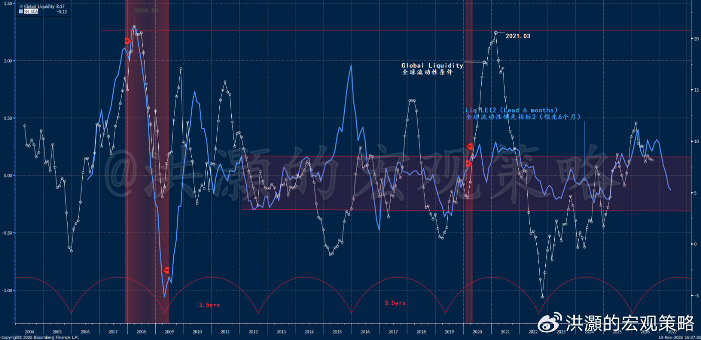

如前所述，我们独有的流动性领先指标领先六个月左右，目前已经从高位开始加速回落，很可能到明年中期前后将降至低位，而且末端仍在下行（图9）。这意味着全球流动性条件甚至很可能在明年年中前后收缩，而不仅仅是增速放缓。虽然这仍是常态区间之内的下行，尚非2008年式的崩塌，但流动性条件下行的斜率陡峭，预示着美股乃至全球市场很可能将风高浪急。

图9：我们独有的全球流动性领先指标预示着全球流动性指标（本身就领先）将继续下行。

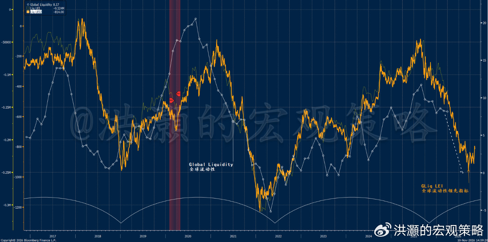

11月5日，VIX从17飙升至28，次日回落至26，一天回吐了约二成的升幅。当天，VIX与三个月期隐含波动率的期限结构倒挂。流动性条件的变化预示着波动率模式将出现转换，表现为VIX低点抬高、远端期货重新定价、实际波动率持续居高，并开始得到信用市场的印证（图10）。人工智能相关的信用早在数月之前就已恶化，而美联储也没有宽松的空间。十月非农就业新增16.5万，远超预期，预测市场给出的十二月加息概率约为78%。局部信用已经承压、而整体信用市场尚未开始重新定价，而政策还在收紧，说明未来市场格局将有更大的变动（图10）。

图10：流动性拐点所到之处，预示着格局的变化。

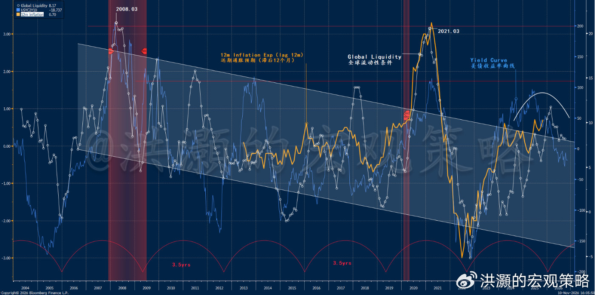

显然，执笔之时，美国大盘的风险尚未尽数释放。标普距离高点仅回撤了约6%，而半导体指数已经从高点回落四成，并且仍将继续回落（图11）。在流动性条件转负的2027年上半年，美国大盘与信用将是链条上接下来要经受考验的环节。如是，长久期美债很可能优于风险资产。十年期美债收益率在升破5%之后已回落至4.86%附近。如果长债收益率已经阶段性见顶，那么随后市场的运行会更像2000年和2007年之后的市场。

即使美联储在十二月继续加息，在增长预期的影响之下，市场利率可能会不升反降。而财政赤字、全球长债抛售潮以及日元套利交易资金回流日本，都可能在增长放缓的初期仍然推高长端收益率，直到增长的放缓越来越明显。伊朗战事若升级，通胀预期也可能死灰复燃。如果人工智能信用压力扩散、股市持续动荡，美联储也可能停止加息，情况恶化时甚至不得不重启量宽。以上任意一个场景，对于股票和风险资产都是不利的，直到美联储重启量宽之后。

总结一下：在去年十一月展望2026年的时候，我们预测了今年流动性条件将见顶回落。我们独有的全球流动性条件指标往往领先市场运行六个月左右，甚至更长。今年一二月份交界之处，我们的流动性条件指标见顶，预示了金银的价格泡沫。而到了六月，半导体价格泡沫一如我们的逆共识预测那样开始崩裂，尽管半导体公司的盈利依然强劲，盈利增长都在翻倍甚至更高。

2027年上半年，我们独有的全球流动性条件模型还将进一步回落。如果流动性条件在2026年一季度见顶，而流动性条件领先市场周期六到十二月左右的话，那么到2027年年中的时间窗口，全球市场的波动率模式将继续从低波动的模式向高波动的模式转换，风险资产也将因为增长受到冲击继续承压。

图11：半导体从六月开始剧烈回调，还将继续回落。

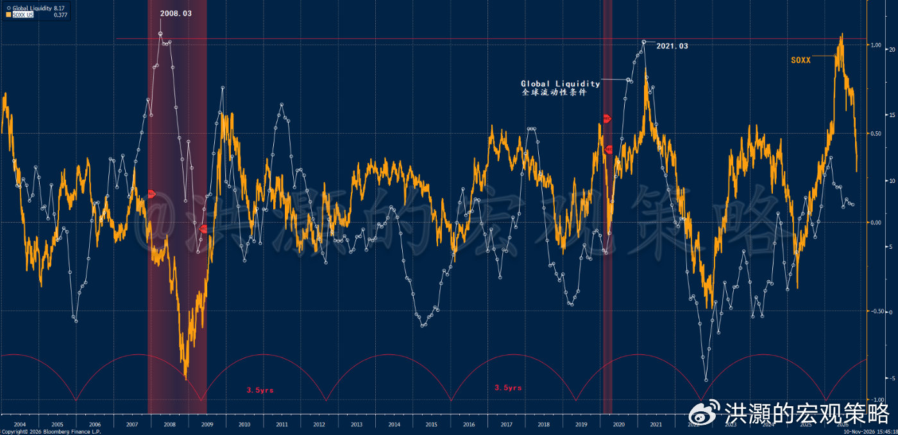

## 四、半导体价格泡沫的崩裂和前景

我们独有的美国半导体周期指标，在今年年中创下了有记录以来的最高读数，远远超过2007年11月、2010年1月和2021年3月的历次峰值（图12）。今年四月底，我们开始指出半导体周期指标已升至史无前例的高位。然而，当时出于对AI技术迭代的判断和我们独有的全球流动性条件指标预测的时间窗口，我们认为半导体的泡沫化行情很可能将像其它泡沫的最后阶段一样，如入无人之境。

图12：半导体周期已经见顶，并将继续回落。

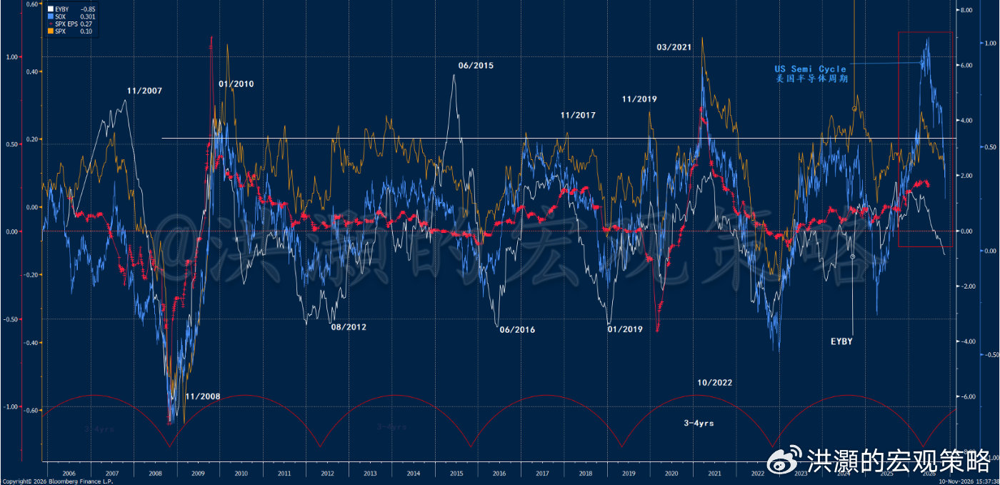

2015年的上半年，我们也是等到当年的六月十五日当天5000点泡沫的顶端，才发表了那篇经典的《伟大的泡沫：800年历史的领悟》。今年六月十二日，我们在下半年展望《洪灝展望2H2026：不如其已》中，预测了全球半导体泡沫将会崩裂，并指出了“未来数月将是观察泡沫破灭的关键时期”。6月22日，也就是在我们下半年展望报告和线下读者见面会结束后的一周左右，费城半导体指数与韩国综指同日创下收盘新高，但也同日成为了此轮泡沫的高点。如今，这个指标正以极快的速度下行，11月5日费城半导体指数单日重挫12%，较高点回落四成（图12）。

图12印证了我们前文讨论的观点。在以往的周期中，半导体周期与我们独有的经济周期指标几乎同时见顶：2007年、2010年、2017年和2021年都是如此。换言之，半导体周期历史上与经济周期步调一致。但这一次，经济周期指标则先于半导体周期见顶转向，而半导体却在此后的两个月里走出了一段创纪录的行情。

这意味着2026年半导体的最后一段上涨并非由经济周期推动，而是由人工智能资本开支的叙事和市场上剩余的流动性推动。这很可能是为什么，在图1中，半导体是倒数第二棒的接力泡沫。历史经验告诉我们，这种两个周期之间的背离在未来的收敛方式，往往是离群的那一方，也就是半导体，将继续向下靠拢，而非经济周期向上去追赶资产价格的泡沫。

年中时，市场共识曾认为，半导体已挣脱了经济周期运行的万有引力，长协锁定了许多半导体公司未来多年的盈利，存储龙头个位数的市盈率显得非常便宜。然而，我们当时的判断恰恰相反：长协锁量，但未必锁价，2021年车用芯片泡沫的破灭殷鉴不远；周期股的估值在周期顶部往往是最低的，但个位数的市盈率不是便宜，而是周期顶部的表征。

图14：虽然实体经济（韩国半导体出口价格）依然强势，但是全球半导体板块已经陨落。

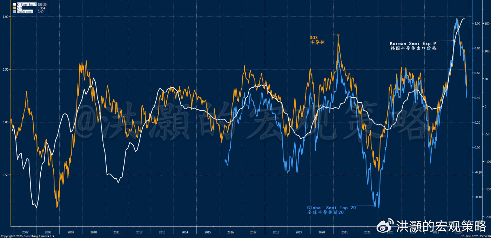

历史上，半导体周期从顶部到底部的时间大约需要十二个月以上的时间：2007年11月到2008年11月的那个6000点的泡沫和全球次贷泡沫的周期下行大约是十二个月，2015年6月到2016年6月5000点的泡沫破灭到触底大约是十二个月，2017年11月到2019年1月是十四个月，2021年3月到2022年10月是十九个月。只有2010年到2012年那一次，由于后危机而产生的形形色色的余震，比如当时的欧债危机和美债评级历史性下调，则长达三十一个月。如果以今年六月为本轮半导体周期的顶部，那么半导体周期的底部时间窗口的打开，大约在明年年中至2028年初之间。而且，在一个创纪录的峰值之后，探底的过程很可能需要更长的时间，而不仅仅是一次歇脚喘气。周期的峰值越高，影子也就越长。当然泡沫的寻底过程并非一路直线下行，中间肯定有大幅的起伏波动。比如，今年六月中旬半导体泡沫开始崩裂了之后，到了八月还是有一波修复的行情。

更值得警惕的是盈利。标普每股收益的同比增速仍在周期高位附近，标普本身仍比一年前高约10%（图14）。历史上，半导体周期领先标普盈利增速约六到十二个月：2017年11月半导体见顶之后，盈利增速在2018年拐头向下；2021年3月半导体见顶之后，盈利增速在2022年回落。这意味着美国企业的盈利增长将在2027年显著放缓，并很可能在下半年转为负增长，如同2019年和2022至2023年。然而，美国的卖方分析师似乎对于这种可能性浑然不觉，依然还没有下调盈利预期。直觉上，如果民主党掌控了两院之后言出即行，导致AI资本开支大幅缩水，那么明年盈利的下调压力将非常明显（图15）。

这种情况下，如果市场对2027年的盈利预测继续保持高位，那就将是最明显的风险。“剥床以肤”，灾祸由远及近，由床脚而至肌肤。半导体周期的调整可以看作是床脚，而往后的盈利与大盘，就将是切肤之痛了。

图15：数据中心资本支出让半导体盈利预期居高不下，但是半导体板块已经开始调整。

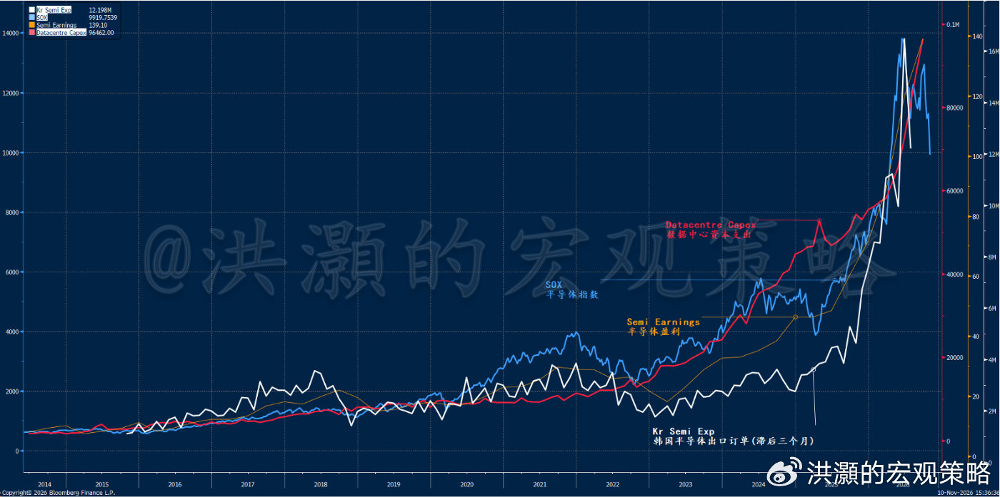

半导体与人民币之间的关系，也是市场共识视而不见的。我们的量化研究发现，人民币汇率周期的变化领先美国半导体周期约四十周：人民币走弱，约三个季度之后半导体走强；人民币走强，约三个季度之后半导体走弱（图16）。2015至2016年的贬值之后是2016至2017年的半导体繁荣，2018年贸易战中的贬值之后是2019年的半导体大涨，2022年贬至7.3之后是2023至2024年的人工智能行情；反过来，2017年和2020至2021年的升值之后，分别是2018年和2022年的半导体下行。

图16：人民币领先半导体周期约四十周；人民币今年强势预示了半导体随后的弱势。

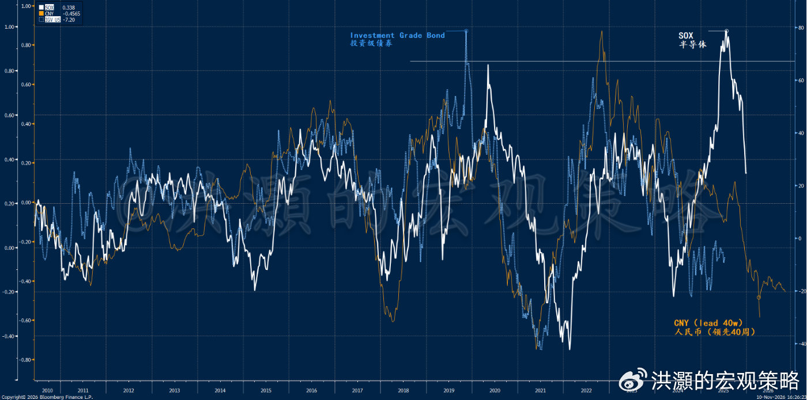

其中的机制，是中国信贷周期对全球经济周期运行的影响，而更重要的因素很可能是人民币套利交易。人民币走弱、中美利差较大时，中国出口商留存美元，资金流向海外，其中相当一部分最终进入了美国的科技与半导体资产；人民币走强时，这部分资金回流，半导体便失去了一个边际买家。由于人民币周期领先四十周，它已经覆盖了到明年年中左右的时段，并且在强势持续了一段时间。2025至2026年人民币的强势，指向半导体的弱势将延续到明年年中。这个时间窗口与我们前述的半导体价格泡沫崩裂之后寻底的时间窗口基本一致。

具体而言，人民币周期领先半导体周期的关系很可能与人民币套利交易和随之而产生的全球流动性方向有关。人民币处于弱势、美国利率更高时，出口商留存美元在海外而不返回中国。此时，中国储蓄流向境外，其中相当一部分很可能最终进入美国风险资产，而价格动量最强的科技与半导体很可能获得更多的配置。这些美元资产的头寸是在数个季度里逐步累积的，对价格的影响自然有滞后。

中国的政策与信贷周期也影响着人民币的走势和中国乃至全球经济周期的起伏（图17）。人民币走弱往往发生在中国放松银根开始的时候，而中国的信贷脉冲长期领先全球制造业约六到十二个月。中国是全球最大的芯片买家，电子又是制造业中周期性最强的部分。也就是说，如果中国货币宽松启动信贷周期，之后中国乃至全球的经济周期都将受益。随后，人民币作为一种强周期货币将随着经济的修复而走强，也预示着经济周期的复苏。反之则反（图17）。

图17：人民币汇率周期处于顶部附近，预示着全球流动性条件将继续收紧。

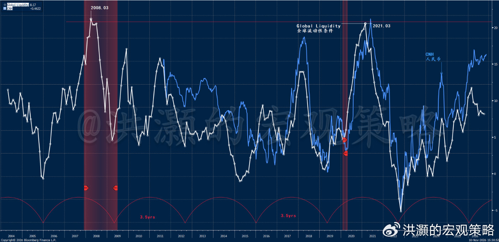

新的周期开启的时候，较弱的人民币提升了中国电子组装与出口的竞争力，下游订单经过十二到二十六周的交付周期和一个补库存阶段，才变成芯片订单，合起来大约四十周左右，与上述人民币周期和半导体周期之间的约40周的领先关系一致。同时，人民币是对风险敏感的货币，往往在全球经济和市场压力最大之时最弱，而那也正是半导体价格接近低点之时，如2016年初、2018年底和2022年底。换言之，人民币的持续强势往往预示着周期的顶部而非底部（图17）。经济周期底部往往伴随着风险偏好的提升，因此风险资产价格高企。而这种周期也将一如历史上的其它周期一样，见顶之后开始回落，周而复始，循环往复。

总结一下这一章节：我们的周期模型早已在六月中旬预测了下半年半导体价格泡沫的崩裂，时间上与后续发生的半导体史诗级崩盘也基本吻合。这个预测与当时的市场共识大相径庭，也因此广受非议和指责。历史经验告诉我们，在泡沫见顶之后，其探底的过程往往需要十二个月左右的时间。有的时候甚至更长。因此，我们预期半导体乃至风险资产的调整还有半年左右的时间窗口。

人民币是一种强周期货币，对于风险偏好非常敏感。人民币周期往往领先半导体周期40周左右，这个关系很可能与人民币套利交易有关。当下，人民币的强势显示周期调整才刚开始，仍然远未达到底部，而半导体周期的底部更可能出现在2027年年中或之后。

## 五、人民币、出口周期与中国股市

图1显示，恒科是这个周期里首个见顶的风险资产，也是这张图中回调时间最长的。要理解中国资产在这次全球流动性轮动中的位置，我们需要把人民币周期、出口周期和股市周期叠加分析。

中国的出口周期大约七年一轮：高点在2007年、2015年和2022年底，低点在2003年、2012年和2019年（图18）。当前，中国的出口周期已经开始回落，但这一次的下行异常平缓，甚至令人感觉不到出口周期的回落。今年一至八月，中国的出口增长约19.5%，进口增长约26.5%。到了九月，出口的同比增长居然加速到30%以上。2025年全年贸易顺差已经达到1.19万亿美元的纪录，而今年年初至今的贸易顺差就已经与这个数相当了。市场当初预期今年出口将在关税压力和基数效应之下放缓。然而，结果却恰恰相反，而经常账户盈余继续创出新高。

图18：中国的出口周期 vs 中国股市。

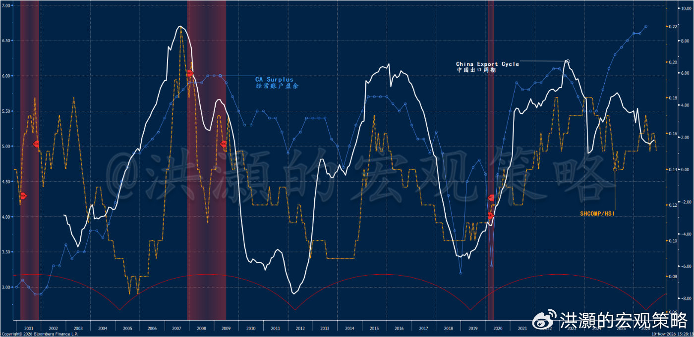

不夸张地说，如果没有净出口快速增长，中国经济今年的增长目标将很难达到。然而，中国净出口的强势折射出来的是外需的强势和内需的弱势，以及两者之间强弱势的云泥之别。问题是，这些顺差带来的美元，究竟去了哪里？这是我曾经在过去两年提出来的中国宏观经济之谜。这个问题我们稍后讨论。

从图18可以看到，如果以史为鉴，中国出口周期很可能在2027年开始放缓。而美联储仍在加息、人工智能资本开支很可能被民主党干预、欧洲能源问题悬而未决、欧盟新的关税也可能出现，尽管中欧达成了第一阶段的初步协议。然而，这个协议看着更像是一个停火协议，而非定义战争结束的和平协议。2008年的次贷危机和2020年的疫情时期，全球需求的冲击都把中国出口周期推得远低于周期底部的正常水平。如果美国或全球在2027年陷入衰退，那么这次出口周期的底部将推迟并更深，修复的时间也将滞后。

上证与恒指的比值与出口周期的关系也是一目了然的（图18）。这个比值在2007年和2015年与出口周期同时见顶。其中最重要的机制是流动性条件的变化。出口繁荣带来了外汇流入。而在2015年之前，央行买入外汇是基础货币投放的主要渠道。那时候，出口上行便直接转化为境内人民币流动性，而A股是一个相对封闭、由流动性驱动的市场。因此，在岸股指的起伏与流动性条件的变化息息相关。

香港则不同，在联系汇率制度下，港元利率和基础货币跟随美联储与资本流动，而非中国的贸易顺差。顺差充盈时受益的是境内资产，因此上证和恒指的比值便随之上升。加上上证偏重工业与周期行业、恒指偏重金融与互联网平台，以及资本管制使得境内外资金无法自由套利，因此这个关系可以维持很长一段时间。2015年之后，央行基本停止了外汇积累，外储长期停留在三万亿美元出头，出口商也越来越多地把美元留在境外。这也解释了为什么今年创纪录的顺差并未带来A股的流动性盛宴。

图19：人民币 vs A股的相关性似乎脱钩。

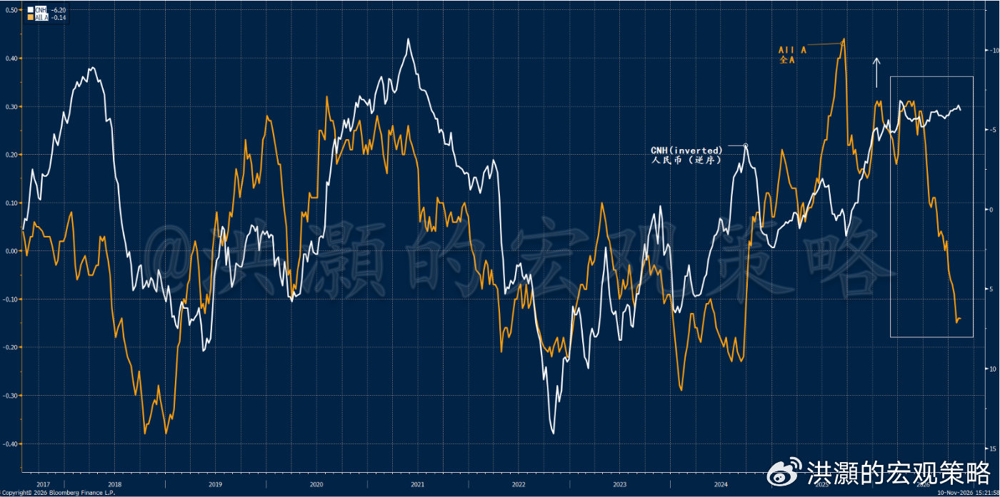

除了流动性，还有几个因素强化了这个关系。一是人民币升值预期。疫情以前，出口繁荣会形成人民币升值的预期，热钱由此通过合规与灰色渠道涌入人民币资产，而A股是持有人民币最直接的方式（图19）。投资者结构上，A股以散户与动量交易为主，贸易繁荣会提升收入与风险偏好，散户会放大涨幅；港股则由全球机构定价，折现率与美国利率挂钩。中国的出口繁荣往往与全球增长强劲、美国利率上升同时发生，如2006至2007年和2022年。美债收益率上升通过联系汇率压制了香港，而A股却正得到流动性的推动。这个比值滞后于出口周期，是因为外储积累、信贷创造与散户情绪都需要时间发酵，而央行起初还会对冲一部分流入。当然，这个关系并不严密：2014至2015年的行情更多由融资杠杆而非出口驱动。部分波动也来自两地各自的政策冲击，例如2021年对香港上市平台公司的监管。

然而，这个历史关系在最近两年好像开始式微了（图19）。这个相关性的变化很可能和我们前述的人民币“套利交易”有关。我们把这个套利交易用双引号括起来，是因为这个人民币套利交易和传统意义上大家理解的套利交易并不完全一样。最近几年，由于人民币贬值预期和利率不断走低，以及美元资产的牛市，可以想象很多出口商在出口交易完成之后把获得的美元收入留在了海外，赚取美元资产的高息回报。我们姑且把这个交易称为“贸易套利交易”。

因此，如果人民币升值预期继续走强、出口贸易商将逆转前几年的做法，开始把境外的美元调回国内。而这个回流今年已经发生了。如是，那条已经中断的、由出口创汇带来的美元转化成人民币流动性的旧渠道就可能重新启动了。海外资金回流可能会使得央行重新购汇释放人民币流动性。因此，只要人民币升值的预期还在，出口周期的见顶回落可能并不就马上意味着海外资金不回流内地。当然，即使资金回流产生了新的流动性，这些流动性在弱风险偏好的大环境里反而可能进一步投向债券而不是股市，进一步压低人民币利率、繁荣债市（图20）。

图20：央行扩表产生的流动性进入债市而非股市。

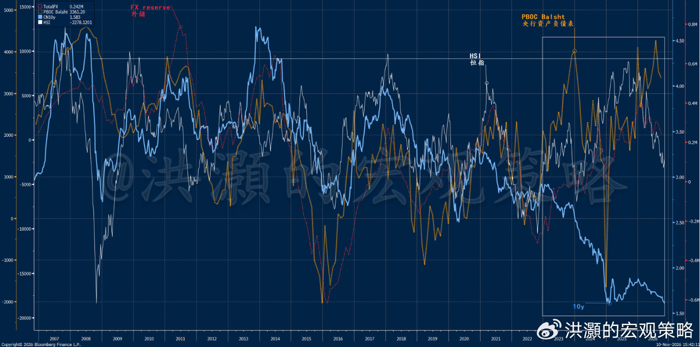

有人会问，如果借入人民币的对冲成本很高，足以抵消利差优势，这个“套利交易”又从何谈起？其实，人民币套利交易本来就是不对冲的，套利大多是隐性的。比如，出口商收入美元却不结汇，把美元存在收益约四到五厘的美元账户里，而成本和负债却是利率约一点五到二点五厘的人民币。对冲成本高，恰恰是不对冲的理由。

数据上可以佐证这一点。2026年2月，出口商的远期结汇对冲比率只有14.2%，即八成以上的美元敞口没有对冲。随着人民币从2024年底的约7.30升至2025年底的6.99，再到今年九月的6.6，银行结售汇顺差占海关贸易顺差的比例，从2024年的-11%升至2025年的17%，再到今年前三季度的42%。九月企业新签远期结汇达574亿美元，为2022年3月以来最高。2025年国际收支的净误差与遗漏项（热钱）为2009年以来首次转正。这些数字显示，“贸易套利交易”是存在的，但在人民币升值趋势中开始逐步平仓。

这个平仓的行为很可能远未结束。结汇率只是从2024年的61.6%升至今年一至八月平均的63.8%，九月为65.3%（图21），而2013至2017年的平均水平约为73%。境内外币存款从2024年底的约8,560亿美元，增至2025年底的1.07万亿，再到今年九月底的约1.2万亿美元。美元在回流了内地，但多数还停留在内地银行系统的外币账户里。如果人民币继续走强，结汇显然还有相当的余地。

图21：人民币结汇率 vs 上证。

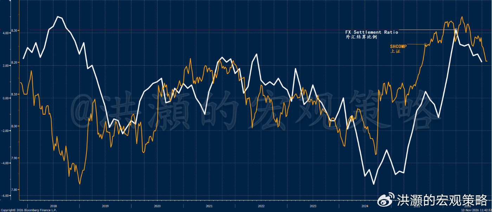

需要分清的是，市场上常说的“人民币借入成本太高”，应该指的是另一种套利交易：投机者在离岸借入人民币以做空。由于央行不时收紧离岸流动性、离岸拆借利率突然飙升，这种传统的套利交易的确代价不菲。它是真实的，但规模与我们上述的“贸易套利交易”相比，应该不是同一个量级的。更大规模的“贸易套利交易”，应该在于出口商与企业的隐性套利。

这个证据可以从三个层面寻找：流量上，是长期偏低的结汇率、顺差与结汇之间的缺口、以及国际收支的误差与遗漏；存量上，是境内外币存款，国际清算银行统计的中国居民在香港、新加坡等地的存款，美国财政部TIC数据中经由香港、开曼和卢森堡等托管地的持仓，以及内地居民购买香港保险、港元美元存款和南下资金；负债上，是中国企业以境内人民币贷款置换境外美元债务、外国发行人大量发行熊猫债，以及人民币在贸易融资中的份额快速上升。

但贸易套利交易最有说服力的证据，是一个可以被证伪的预测。如果贸易套利头寸确实存在，人民币的升值就应迫使它平仓：结汇率应当上升，企业的美元存款应当下降，人民币的升值应当自我强化，而亚洲账户在海外资产上的减持也应与人民币走强同时发生。前文讨论的数据显示，这些数据已经开始变化。当然，没有任何数据会把这类贸易套利行为标注为“套利交易”，部分海外留存的美元也可能只是出口商的营运资金，或者反映了某种信心不足。但无论动机如何，只要人民币保持升值趋势，这些钱都会回家。

我们再看一下央行资产负债表与市场的关系。在2007年到2022年，外汇流入、央行扩表、国债收益率与恒指基本同向而行，是一个完整的流动性周期。但自2023年起，这个相关性就不复存在了。央行扩表的同比增速在2023年和2026年两度创下本轮高点，十年期国债收益率却从约2.9%跌至约1.6%的历史低位（图20）。

尤其值得注意的是，今年三月PPI已经结束了41个月的负增长，二季度升至约4%，而收益率仍然在创新低。流动性不再带来再通胀，而是流入债券，这是典型的流动性陷阱。PPI的上涨来自反内卷的供给收缩和油价，是成本推动而非需求拉动，CPI始终徘徊在一个百分点上下。而出口商结汇所得的人民币存成了存款，银行再把存款投向债券，这也是收益率不断创新低的重要原因之一。

流动性上升往往同时意味着收益率和股价的上升。如今，三个流动性指标在同时回落：央行扩表从今年的高点缩减，外储增长随美元反弹与黄金崩盘带来的估值损失而放缓，恒指动量已明显转负，而十年期国债收益率仍在逐渐逼近新低（图20）。恒指在2027年上半年面临的是逐渐消退的流动性。下一轮上行的触发点还是需要央行扩表重新拐头向上。

恒指是目前唯一仍与央行流动性紧密相关的资产。2023年和2025至2026年的两次高点，都紧随央行扩表的高峰。但今年秋天，即使央行扩表一度冲高，港股也未能幸免。10月22日恒生科技指数单日跌近五个百分点，是一次约三倍标准差的冲击，也是过去三年最严重的抛压之一。在最近的专属报告《洪灝：谁在抛售港股》里，我们通过逐只查阅托管数据发现，抛售的主力是被迫应对赎回的内地基金与去杠杆的对冲基金。其原因有三：第一，在联系汇率下，香港的流动性由美联储决定，而美联储还在加息；第二，央行的扩表大多流向境内的国债、再贷款和支持A股的工具；第三，只要A股承压，港股便会成为内地基金筹集现金的渠道。不过2023年的先例仍然有参考价值：那一年央行扩表在年底冲高，恒指却继续下跌，直到2024年1月才见底，此后展开了2024至2025年的反弹。央行扩表没有立即拯救市场，但港股还是在一两个季度之后筑出了底部，开始走强。

我们专有的中国经济周期指标给出了类似的时间窗口。这个指标与恒指动量、滞后两到三个季度的核心通胀。这些指标都在2025年同时见顶，恰好落在三到四年周期的顶部。如今三者都在下行（图22），周期的低点大约在明年二季度前后。这与我们港股领先指标给出的十一月中、十二月中和明年一月中的筑底时间窗口是吻合的。不过，周期的下行阶段很可能尚未走完，而这个周期的最后阶段往往是风高浪急、险滩频频的。

图22中最重要的信号，是人民币与经济周期的背离。以往，人民币在周期上升时走强，在周期下行时走弱。如今，人民币接近图22上周期的高点，而经济周期与恒指动量却在下行。人民币的强势来自顺差与结汇，而非内需的强劲。在现在这个周期里，强势的人民币收紧了金融条件、压低了进口价格，反而加强了核心通胀与周期的下行。2018年和2022年的周期底部，都伴随着人民币的走弱。因此，人民币升值动量的放缓，很可能是周期探底的重要信号之一。

图22：中国经济周期仍将放缓，通胀将进一步走低；人民币似乎已运行至周期高点。

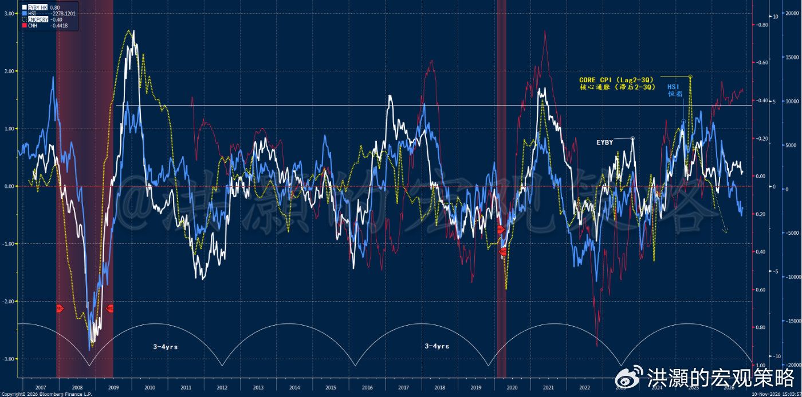

滞后的核心通胀仍指向下行，意味着未来两个季度经济周期仍将放缓。通胀、消费偏弱，房地产板块仍在下行，而约四个百分点的PPI并未传导至核心消费价格。如果经济周期能筑底回升、那么滞后核心通胀需要企稳、人民币升值的势头需要停歇、以及央行重新且持续扩表。图xxx显示周期的低点大约在明年二季度前后。这与我们港股领先指标给出的十一月中、十二月中和明年一月中的寻底时间窗口是吻合的（图23）。然而，如果人民币继续大幅升值，或者一次新的全球危机再次降临，那么将会让周期的运行进一步恶化。而可能的触发点包括人工智能信用的崩裂、日本市场见顶、日元套利交易的逆转和能源问题。

图23：港股进入寻底过程，但是道阻且长（上图为长期领先指标、下图交易性领先指标）。

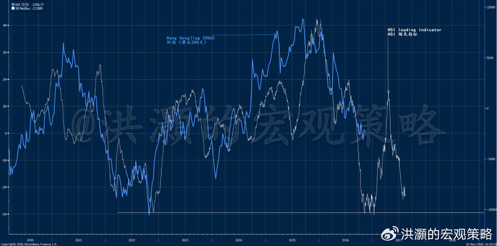

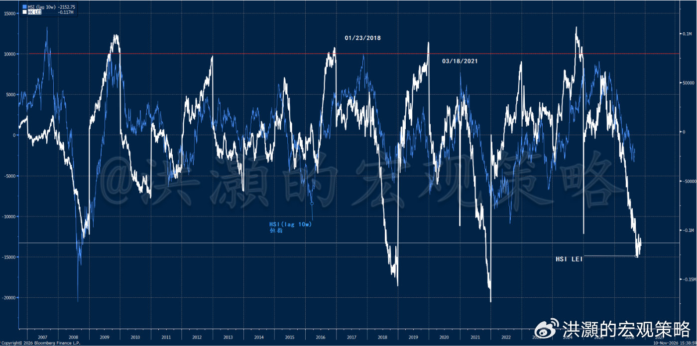

总结一下这个章节：2027年，中国的出口周期很可能将开始放缓。历史上，出口周期的下行往往导致人民币走弱、结汇率下降、人民币流动性边际收缩，风险偏好下降和风险资产价格承压。然而，过去两年，这个历史相关性在减弱，很可能是因为人民币升值预期导致出口商平仓“贸易套利交易”，叠加离岸资金监管的强化，出口商加速把曾经在海外留存的、赚取高息美元资产回报的美元回流内地。尽管如此，人民币升值而带来的流动性回流由于风险偏好的压抑，并没有流向股市，而是流向了债市，反而压低了债券收益率到历史最低水平。

这个“贸易套利交易”平仓引起的海外美元回流很可能也是导致海外市场的流动性边际收紧的重要原因之一，使得海外存量的流动性如前文所述在各类资产之间轮动，吹起然后刺破了今年一个又一个的泡沫。明年，随着经济周期进一步探底，人民币升值的预期将边际减弱，但是这种边际的变化很可能不足以改变人民币长期升值趋势的预期，因此也很难改变海外流动性条件继续下降的趋势。因此，市场真正的挑战在明年。

## 六、中国的储蓄过剩与西方的债务危机

自从2010年从华尔街工作了十几年回国之后，中国与全球经济和市场的关联性总是我研究中国市场的主要角度之一。由于这个全球的视野，我对于中国市场和经济的分析往往有与市场共识不一样的见解。

中国的经济结构与世界其他主要经济体之间互为镜像。美国、欧洲和日本储蓄不足，叠加疫情以来的供给冲击，导致资金价格飙升。于是，美联储不得不加息、十年期美债升破5%至近二十年最高、英日德法的长端利率也纷纷创下了数十年新高。中国这边则是储蓄日益过剩、内需严重不足，资金价格跌至历史低位。十年期国债收益率已经下行到了1.6%，中美十年期利差一度超过300个基点。这种全球的经济结构，真的是 “瓶之罄矣，维罍之耻”。这个框架，在过去十几年我的报告里都有不断深入的分析，并在由中信出版社出版的畅销书《预测：经济、周期和市场泡沫》中有详细的、总结性的论述。

过去十余年，中国的过剩储蓄主要通过出口价格和人民币汇率两条渠道输出到海外市场。中国PPI长期为负，让中国商品的出口价格更加便宜。同时，人民币汇率偏弱，出口商把出口所得的美元留在境外。在2015年之前，央行用美元外汇储备购买美债；2015年之后，美元通过私人部门留在境外获取美元资产收益率。

数据也清晰地显示了这一点：2025年银行的对外外币资产增加2,500亿美元至1.39万亿美元，私人部门全年对外资本输出达8,080亿美元，其对外净头寸转为正值。但央行的外汇储备却波澜不惊（图24）。出口商存入美元，银行把美元投向海外，这就是中国的顺差在不知不觉中为海外风险资产融资的渠道。因此，人民币很可能是一个被全球市场忽视的、重要的融资货币。

图24：中国出口周期的上升，但外储波澜不惊。

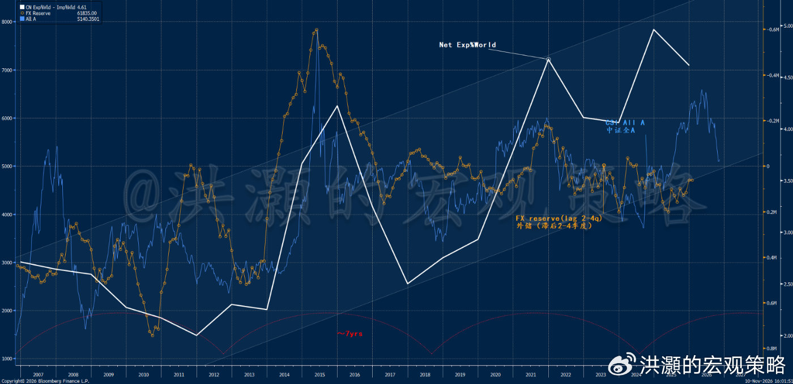

坦白地说，今年中国的失衡并未改善，反而加深了。顺差创下纪录，出口增长约二成；但一至八月房地产投资下降了19.2%，固定资产投资下降了7.2%，CPI徘徊在0.8%至1%，青年失业率约15%，二季度GDP增长放缓至4.3%。今年三月的重要会议把今年的增长目标定为4.5%至5%，为1991年以来最保守的目标；第十五个五年规划以科技与供给侧为重点，需求结构着墨不多。PPI在三月转正，人民币从7.3以上升至6.71，实际汇率多年来首次显著上升（图25）。然而，PPI因成本而非需求上升，人民币升值并未削弱出口，结汇所得的人民币在金融体系内部转向债券，而非流向消费。因此，今年的结构性变化仍然不是真正的再平衡。真正的再平衡，应当表现为经常账户顺差占GDP比重下降、居民消费占比上升、核心通胀由于需求上升而回暖、以及因信贷需求恢复而带来的债券收益率上升。目前，数据上还没有看到这些迹象。

内需下沉、顺差继续累积、收益率不断创新低，与结汇数据的变化，实为一体两面。今年进口增长约26%，快于出口约20%，但主要由人工智能相关设备拉动，并非居民需求的回暖。换言之，2026年中国的失衡仍在扩大，只是调整的压力从出口价格转向了汇率。过去中国通过下跌的出口价格与偏弱的人民币向全球经济输出过剩的储蓄，并把美元循环到海外。如今人民币走强、美元回家，但在风险偏好低迷、内需不振的情况下，回流的资金流入了债券，把收益率压在历史低位。

对于中国本身，如果内需没有实质性的改善，顺差仍将居高不下，结构性调整的重担将继续落在汇率上，那么人民币长期将仍有升值压力。外汇储备则大体持平，因为央行不再大规模买入外汇，结汇走的是商业银行体系。去年外储的增长大多来自估值效应，而美元自二月以来的反弹与黄金的崩盘，已使这部分增长消退。

图25：人民币名义汇率显著上升，实际汇率也跟随有所上升。

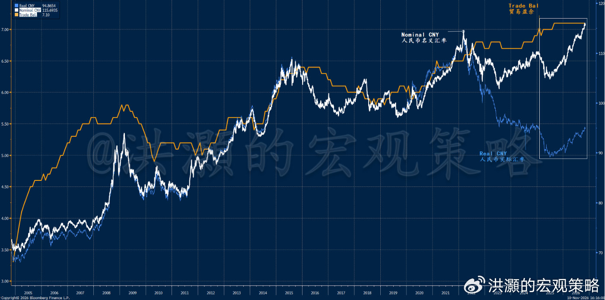

结汇所得的人民币若不能转化为消费与投资，就会继续流向债券与高股息资产，十年期国债收益率维持在低位的可能性，大于持续上行的可能性。人民币升值本身也具有通缩效应。实际汇率若继续上升，出口利润率将受到挤压，顺差终将收窄，导致更多的储蓄回流境内。

图26：风险偏好低迷，压抑股票、黄金和债券收益率。

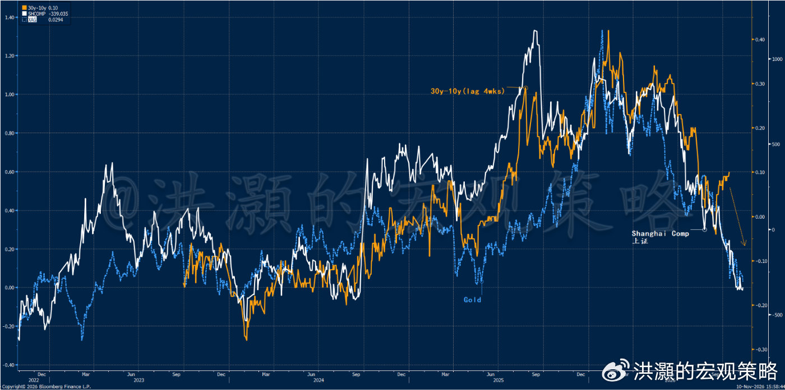

对于全球市场，人民币“贸易套利交易”的逆转，对海外风险资产意味着一股持续而隐蔽的卖压。今年五月，海外投行估算人民币套利规模约八千亿美元，并认为一旦平仓，人民币有可能升至6甚至5以内。当中国的海外储蓄开始回家，另一个储蓄大国也在发生类似的变化。日本本国长债收益率创历史新高，日本的保险公司和养老金开始有理由把资金调回国内。日本财务省在四、五月间不得不动用了近800亿美元干预汇市阻碍日元贬值的势头，甚至为此减持美债。对冲基金的日元净空头在六月初升至2024年7月以来最高。而日元的贬值预期曾经是支持日元套利交易的重要因素。

全球两大债权国的资金同时回流，意味着全球长期资本的供给结构性地减少。而与此同时，发达经济体的财政赤字和科技巨头、新云公司的大规模发债，正在争夺这些长期资金。即使增长放缓，全球长端利率也很难回到过去的低位了。虽然我们认为十年期美债在5.3%附近短期“交易性见顶”，但从更长的时间看，两个储蓄大国的资金回流，将使长端利率的底部继续抬高。

贸易上，中国如此庞大的顺差必然招致贸易摩擦，而且不仅只来自美国。今年美国的关税体系经历了多次重置：二月最高法院裁定IEEPA关税违法，特朗普随即以第122条对全球征收15%的关税；五月14至15日北京峰会，双方大体同意以约10%的301关税取代被废止的IEEPA关税；九月25日华盛顿峰会，双方同意为各自300亿美元的进口商品磋商降税框架。而釜山峰会达成的一年关税休战期即将在11月到期，美方表示并不急于延长。可以预见，欧洲和其他新兴市场也会加强对中国进口的防范。外部的压力，与人民币升值的压力，将在未来一两年里相互叠加。

这面镜子最终指向一个问题：中国是选择由内需来承接过剩的储蓄，还是继续让汇率承担结构性调整的大部分压力。前者意味着真正的结构性再平衡，国债收益率将因信贷需求的恢复而回升；后者意味着更强的人民币、持续的低收益率，以及全球风险资产的逆风。这将是2027年和未来全球经济格局的一个关键变量。

## 七、风云际会2027

过去一年里，一池开始边际缩减的流动性在一众资产价格泡沫中轮动，从恒指到加密，从金银到半导体、最后从铜矿到能源，泡沫先后见顶。今年应该是历史上资产泡沫集中破灭最密集的的一年。在去年十一月展望今年的时候，我们根据历史上周期运行的规律，预测今年资产价格泡沫传递的顺序和时间点。

去年十一月，我们独有的全球流动性量化模型显示了全球流动性条件将于今年一二月份交界的时候见顶。果然，金银在今年的1月30日随着流动性条件的达峰见顶，并且由于交易仓位的集中而导致了史诗级的踩踏行情。虽然我们继续看好金银长期的配置价值，但是我们短期的交易观点与我们的长期观点看似相悖，其实并不矛盾，在1月30日预警之后，我们一直保持空仓的状态观察，等待更好的长期配置价格。

今年六月中旬展望下半年的时候，半导体价格泡沫的破灭是我们的核心预测之一。我们当时认为未来的六个月是观察泡沫破灭的关键时间窗口。毕竟，我们独有的全球流动性条件指标已经在年初一、二月份的时候见顶了，而这个流动性指标往往领先风险资产价格的波动六到十二个月。如今，韩股和半导体都如期经历了有数据历史以来最惨烈的下跌之一。然而，我们的模型依然显示回调的压力仍远未结束，而泡沫破灭之后的最后下行阶段里，波动往往是最惊心动魄的（图27）。

图27：成长股进入崩盘的最后阶段。

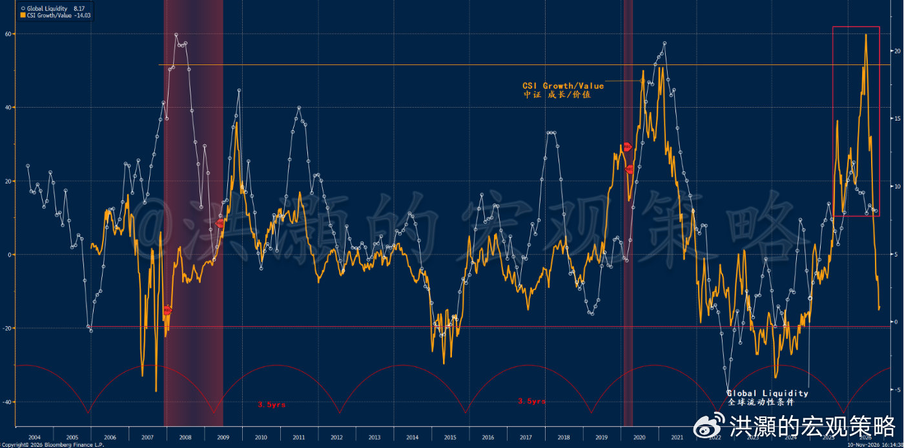

虽然六月的时候我们是市场上屈指可数的、逆共识地预测了这次半导体泡沫破灭的经济学家，我们其实是最不希望看到这个预测成真的。因为泡沫破灭之后，往往人心涣散，不利于建设。而泡沫破灭之后的消化和修复往往需要时间。同时，我们必须强调，我们认为人工智能的革命才刚刚开始，而长期看，人类社会对于半导体和AI相关产业链的需求，是被严重低估的。执笔之际，我们的数据显示，韩国半导体出口价格依然在攀升，半导体公司的盈利增长依然凌厉，研究员的盈利预测依然尚未回调。这些情况都显示了，经济对于半导体的需求依然非常强劲。

我们去年十一月展望今年的时候，还根据周期运行的规律预测了今年的原油和能源行情。然而，我们当时并不知道、也没有人会知道，究竟什么因素将导致这一场轰轰烈烈的原油行情。我们只是按照周期的规律和量化模型进行预测。战争是一种二元不确定性，是无法根据历史数据用模型模拟的。即便是最有经验的战略专家，也只能根据历史经验和地缘政治格局进行情景分析。而更令人意外的是，这次伊朗战争在美国军力绝对优势、甚至斩首对方一众将领的情况下仍在继续，霍尔木兹海峡依然封闭，但是油价已经开始从高点回落。

今年各类资产价格泡沫先后依次破灭，显示的是在资金成本逐步抬高的背景下各类资产对于流动性的敏感度。那些对于流动性条件变化极度敏感的资产，如恒科和加密在去年年底就开始回落；然后就是五千年来的货币信仰、流动性本尊不灭的真身金银史诗级的崩盘。由于投资回报优渥、利润丰厚，半导体对于资金成本的上升并不特别敏感——直到新云公司和人工智能相关的资本支出大幅增加。在过去几年西方政府无节制地借债补充财政缺口的背景下，这些万亿美元级别的资本支出与本已捉襟见肘的西方政府争夺资金，推高了融资成本。而这些基准利率水平的抬升，让许多新云公司的债券沦陷成了垃圾债级别。

这个资产泡沫破灭的顺序还揭示了实体经济里面的供给瓶颈和缺口。供给的缺口越大，瓶颈越紧，对于资金成本上升的敏感度就越低。看看最后见顶的铜矿和能源，由于过去几年的投入减少，甚至过去二十多年以来对于无形资产和人力资源的偏好，而对于制造业能力和实体商品资源的忽略，导致了疫情之后供应链的紧绷。而伊朗战争和霍尔木兹海峡的封锁更是凸显了实体经济相对于虚拟无形经济的重要性。因此，对于中国消费羸弱、经济结构失衡的批判其实也是对于美国极端消费主义的批判。这是镜子的两面。

这种对于虚实经济认知的鸿沟直接反映在全球经济结构的失衡，是造成中国储蓄过剩、内需不足的文化上最主要的原因。中国人勤奋务实，自古以来就长于制造，重视制造。自力更生、自給自足的精神一直深入人心。这解释了为什么，硅谷是产生各种各样的资产泡沫的密集地区，因为西方文化善于宏大叙事的特长和在流动性泛滥的背景下孕育出来的、极度激进的风险偏好。如是，中国内需不足的问题很可能在更高维的角度上是历史文化问题，与西方文化截然不同，也很可能因此很难发生快速的改变。这种文化传承，可能也解释了为什么内需在未来几年的规划中被疏于着墨。当然，其它结构性的、更具象的因素也同时在压抑消费。

在今年一二月份之交运行到了高点后，我们独有的全球流动性条件指标持续下行。与此同时，我们的全球流动性条件领先指标也继续下行，预示着2027年上半年流动性很可能将进一步收缩。由于流动性与资产价格和经济周期的领先关系，我们认为风险资产在2027年上半年很可能还将继续承压，市场的风险资产在2026年经历了轮番的泡沫破灭之后，在2027年的上半年将出现领导权的真空。换言之，2027年上半年将很难找到像过去两年那样波澜壮阔的机会。而通胀在未来几个月惯性走高之后，终将由于增长放缓甚至下行而通胀压力减轻，使得美联储暂停加息。如果民主党主导的两院颐指气使、一意孤行，把政治报复的重要性放在了经济建设和科技发展之上，那么在经济增长和流动性条件收缩的背景下，资产价格的压力将进一步加剧，甚至可能迫使美联储出于稳定市场的需求考虑，重启量宽。

供给瓶颈和稀缺等因素导致资金成本上升，西方政府债台高筑、入不敷出叠加人工智能大手笔的资本开支加剧的了利率上行的趋势。除此之外，还有另一条市场忽略了的流动性供给渠道今年也出现了显著的变化。许多人对于人民币贸易套利交易产生的流动性视而不见。去年下半年以来，人民币显著升值。以前由于人民币贬值预期，出口商在交货后把美元收入滞留在海外，以赚取更高的美元资产收益。这种中国出口获得的、滞留在海外的美元资产外汇积累，是海外美元流动性的重要来源之一。然而，今年由于人民币升值预期，海外的中国美元开始回流内地。对于海外券商账户投资海外股市的监管也加强了，海外华人家族信托的税收征管也从严了。

可以想象，海外的美元流动性因此而必然减少。有市场估算，这种滞留海外的中国美元可以达到8,000到10,000亿美元的规模。这些流动性在回到内地市场后并不像以前那样流入股市等风险资产，而是由于风险偏好的压抑而流入了债市，压低中国债券收益率到历史最低水平，导致国内市场流动性泛滥却又无用武之地。虽然央行已经出手干预，上调了外汇存款准备金率200个基点以延缓人民币升值的势头，但是人民币升值的预期很难马上发生逆转。因此，这个历史上重要的流动性供给渠道在未来几个月里很可能还将继续淤塞，压抑风险偏好。

中国的出口周期开始从高处回落，但是结汇比例相对于历史长期平均水平来说，还有上升空间。换言之，人民币升值的趋势虽然出现了微妙的变化，但是很可能一时也很难察觉，使得海外美元由于人民币升值预期暂时不减而继续回流内地，人民币贸易套利交易一时半会儿还停不下来。这就和当年的日元套利交易产生的流动性供给一样。当年最流行的套利交易，就是以日元贬值和持续低利率的预期形成的。但这种套利交易产生的流动性供给是非常脆弱的，一有些许风吹草动就会树倒猢狲散。比如2024年8月。

我们的模型显示中国经济周期很可能将进一步放缓，通胀将进一步回落。如是，模型虽然显示短期的市场从交易角度看来应该至少有一个可交易的反弹。但如果宏观环境进一步放缓的话，那么中国市场的风险资产价格将进一步承压，或者至少需要一段时间来修复。我们的美国市场情绪周期指标已经基本上运行到了一个相对较低的位置。除了2020年的疫情大崩盘之外，我们的情绪周期指标的位置可以说基本上暴跌到与2003、2009和2018年相当的水平。如是，美股的可交易反弹在我们执笔的时候，应该已经展开了（图28）。

图28：美国周期指标深度下探。虽然标普离历史高点不远，但是今年的可交易反弹已经展开。

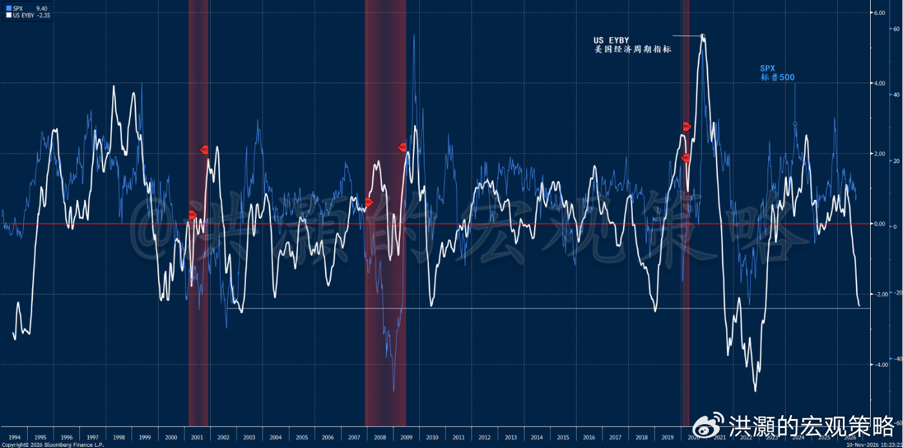

长期看，中国的储蓄和西方的债务危机是一个镜子的两面。中国的巨额储蓄产生的投资必然对应的是极具竞争力的制造业，并且制造业产生供给的能力远远超出了内需的水平。而西方的制造业早已年久失修，加之长年因为消费过剩，政府以及居民部门都入不敷出。因此，中国的出口能力吸引了海外的储蓄而进行产能投资，这一部分产能其实是代表西方消费而投资的。如果把全球的投资和储蓄统一来看，那么它们必然是平衡的，而所谓中国经济结构性的投资失衡，对应的必然是西方经济也同样的结构性消费失衡。由于地缘政治和上述讨论的文化关系，这种结构性的失衡并不是发一些消费券可以解决的短期的问题。

全球流动性在今年初见顶，投机资产的接力在八月完成最后一棒，半导体周期在六月创下纪录后急速下行，接下来是美国企业的盈利减速，然后就是美股和美国信用债。而各个周期的底部，大致会在2027年下半年前后交汇：中国出口周期开始放缓；中国经济周期的底部窗口在2027年年中左右开始打开，但是中国市场已经先行；全球流动性的底部大约在2027年下半年；美国半导体周期的底部窗口在2027年年中至2028年初。如果它们大致同时见底，明年下半年很可能将是一个同步的转折点，为2028年全球风险资产的修复打下基础。而在此之前，明年上半年市场将面临真正的挑战，流动性收缩与盈利减速将同时发生（图28）。

有几个信号决定了转折的时间。其一是美元与美联储。如果2027年美元见顶、美联储停止加息，那么将有助于全球流动性周期的重启，而十年期美债收益率的阶段性见顶，可能是第一个先兆。其二是人民币的升值势能。不一定需要人民币贬值，只要升值的同比动量放缓，就有助于半导体与中国经济周期见底。其三是中国央行。持续的扩表，而非一两个月的脉冲式宽松，才能帮助中国市场筑底。最后，人工智能的信用压力是否扩散到宽广信用市场，决定了这一次的底部是类似2016年和2019年的周期中调整，还是类似2008年和2022年的深度调整。周期不是闹钟，而今年许多史诗级的冲击已经打乱了多个周期的节奏。因此，我们对2027年关键时间节点的判断应作为时间窗口来看待。

图29：美债收益率平坦化预示着明年增长放缓和美股承压。

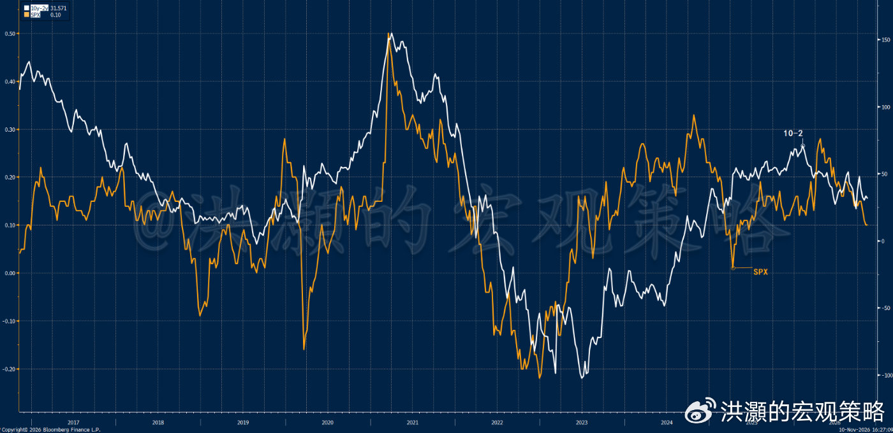

反者道之动。潮汐有序，涨潮退潮，前浪后浪。过去两年，我们看到的是一池逐步缩减的流动性在全球资产之间的接力与退潮。2027年我们要学会等待和忍耐，静候那各个周期交汇的低点，等待下一次潮涨。市场定价的错误，往往出现在共识最一致的地方。当共识仍在讨论美联储是否加息、人工智能泡沫是否破裂时，其实我们这些问题的结论早已了然于胸。我们更关心的是美元何时见顶、人民币升值的动量何时消退、以及中国的储蓄最终会去向何方。

洪灝  
2026.11.12
