# 洪灝展望2027：洊雷未止，一波万波（2/2）

- 作者：洪灏
- 发布：2026-11-14 07:00（文末署名 2026-11-12）
- 来源：[微博头条文章](https://weibo.com/ttarticle/p/show?id=2309405365048922210362)
- 原图：[`images/`](./images/)

> 正文由微博会员页面逐段读取，以下按原章节完整整理核心论证、关键数字、时间窗口与图注；页面导航、推荐阅读和评论未收录。图 8—29 共 22 张原图已按页面顺序保存。

## 2026 回顾：积薪厝火，周期如期

作者回顾 2025 年 11 月以来的主要判断：美联储可能重启扩表，但远期通胀构成硬约束；2025 年 12 月停止缩表并买入短债后，2026 年 9 月 16 日又加息 25 个基点至 3.75%—4.00%，十年期美债升破 5%。末日期权、雪球与被动投资把市场变成“波动率抛售机器”；11 月 5 日 VIX 从 16.61 单日飙升近 70%，标普跌 4.36%、纳指跌逾 6%。

半导体周期指标在 4 月底创纪录，费城半导体与韩国综指于 6 月 22 日同日见顶；11 月 5 日费半单日跌 12%，较峰值回落约四成。金银方面，1 月 29 日预警后黄金从约 5,600 美元、白银从约 121 美元开始暴跌。原油在伊朗战争后曾逼近 120 美元，4 月 8 日停火时单日跌约 16%。中国成长相对价值的超额收益在 6 月达到极端，此后科创 50 近乎腰斩，沪深 300 于 10 月 22 日进入技术性熊市；港股抛售则被解释为基金赎回和对冲基金去杠杆造成的流动性事件。

## 三、全球流动性周期

全球流动性条件模型在 2026 年 1—2 月之交见顶。历史上，该指标通常领先风险资产大幅回撤约六个月，有时更久。本轮顶部远低于 2008 和 2021 年，更接近 2011、2014—2015 和 2017 年，说明泡沫更多来自金融杠杆、拥挤仓位、期权结构和 AI 资本开支叙事，而非特殊量宽。

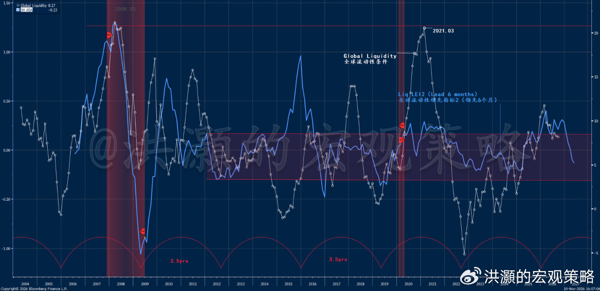

领先指标继续加速下行，可能在 2027 年中附近降至低位，意味着流动性条件可能实际收缩。

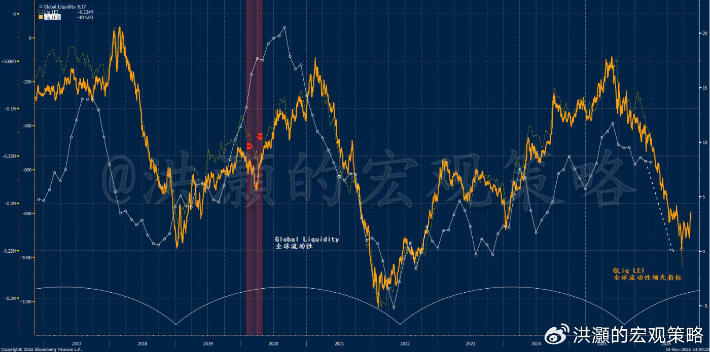

11 月 5 日 VIX 从 17 升至 28且期限结构倒挂；AI 相关信用已恶化，整体信用尚未充分重定价。10 月非农新增 16.5 万，预测市场给出的 12 月加息概率约 78%。

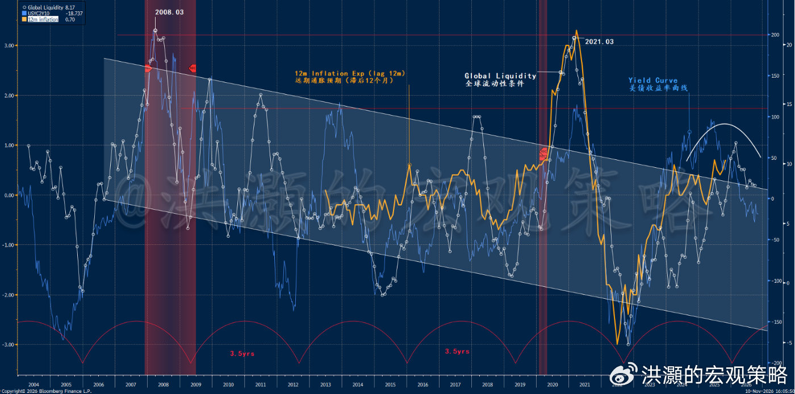

标普仅较高点回撤约 6%，半导体已回落四成，因此美国大盘与信用可能是下一环。长久期美债可能优于风险资产；即使美联储继续加息，增长放缓也可能使市场利率不升反降。总体结论是：2027 年上半年低波动转向高波动，风险资产继续承压。

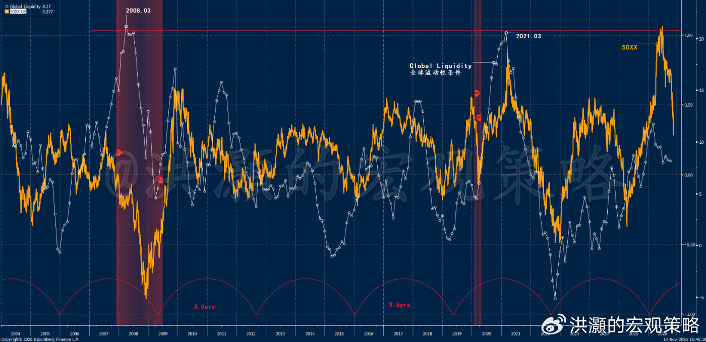

## 四、半导体价格泡沫的崩裂和前景

美国半导体周期指标在 2026 年中创历史最高读数，远超 2007、2010 和 2021 年峰值，随后快速下行。

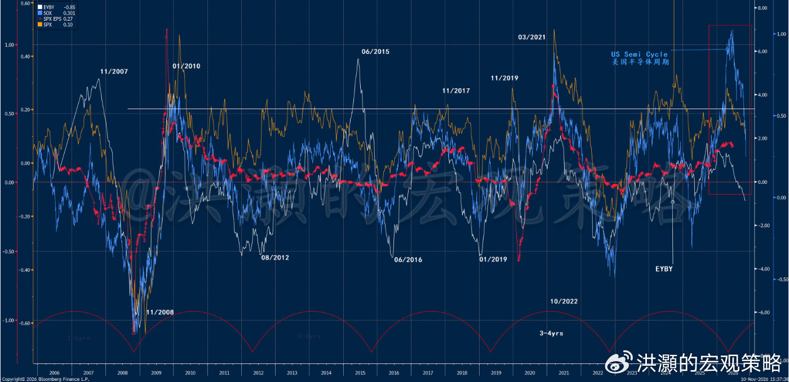

历史上半导体周期从顶到底通常需要 12—19 个月，2010—2012 年异常周期长达 31 个月。若本轮顶部为 2026 年 6 月，底部窗口约在 2027 年中至 2028 年初。作者预计美国企业盈利增速在 2027 年显著放缓，并可能在下半年转负。

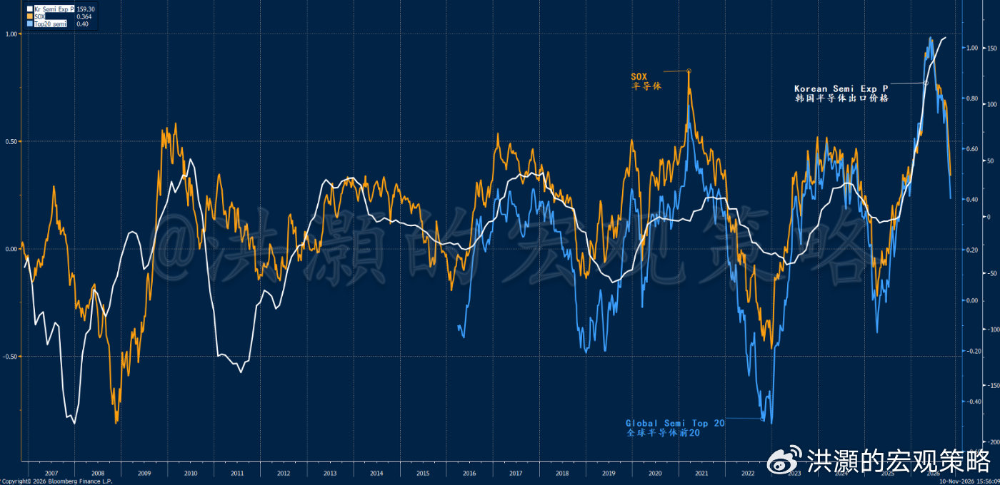

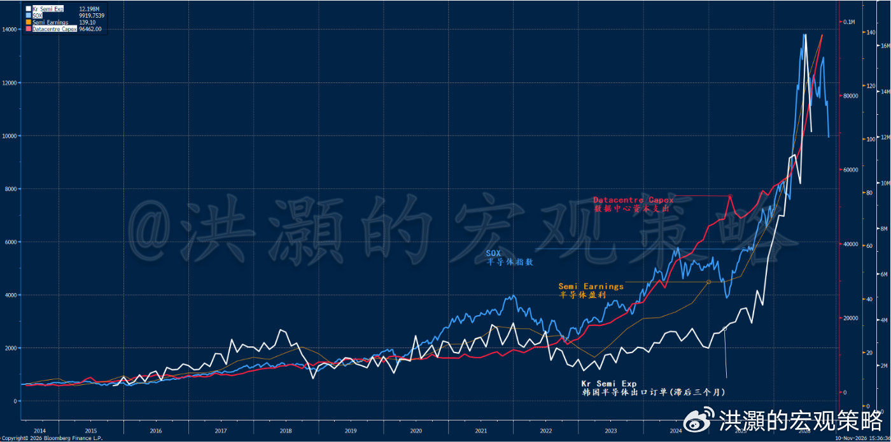

量化研究发现，人民币汇率周期领先美国半导体周期约 40 周：人民币走弱约三个季度后半导体走强，人民币走强约三个季度后半导体走弱。机制包括中国信贷周期、电子订单交付与补库存时滞，以及出口商美元留存形成的边际资金流。2025—2026 年人民币强势因而指向半导体弱势至少延续至 2027 年中。

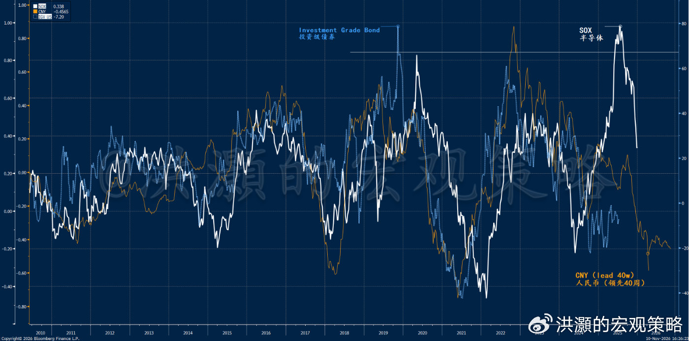

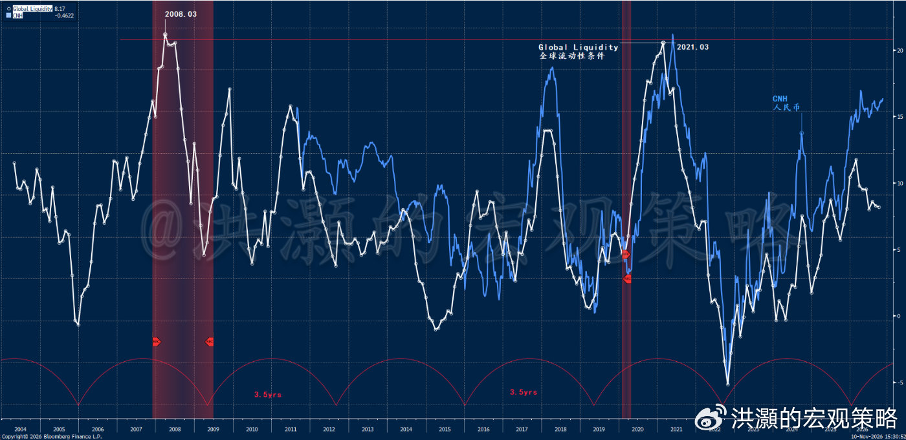

## 五、人民币、出口周期与中国股市

中国出口周期约七年一轮，高点为 2007、2015、2022 年底，低点为 2003、2012、2019 年。2026 年 1—8 月出口增长约 19.5%、进口约 26.5%，9 月出口同比超过 30%；2025 年顺差 1.19 万亿美元，2026 年迄今已接近该规模。作者预计出口周期在 2027 年开始放缓。

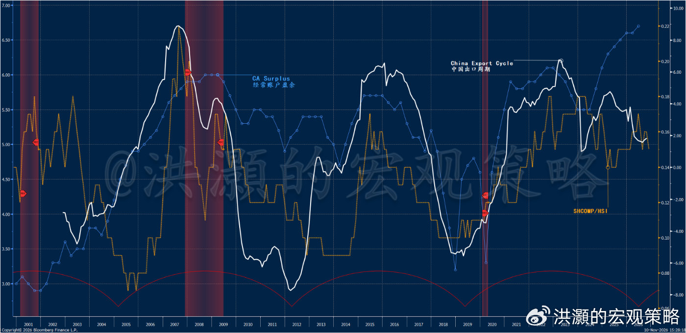

2015 年后央行外储大致稳定，出口商越来越多把美元留在境外，创纪录顺差不再自动带来 A 股流动性。

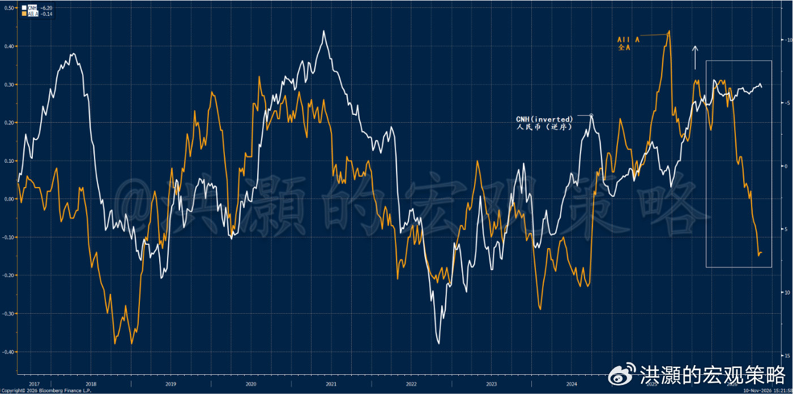

作者把“出口商收入美元不结汇、负债和成本留在低息人民币端，且不做对冲”的结构称为“贸易套利交易”。人民币升值迫使头寸平仓，美元回流国内，但在低风险偏好下主要流向债券而非股票。

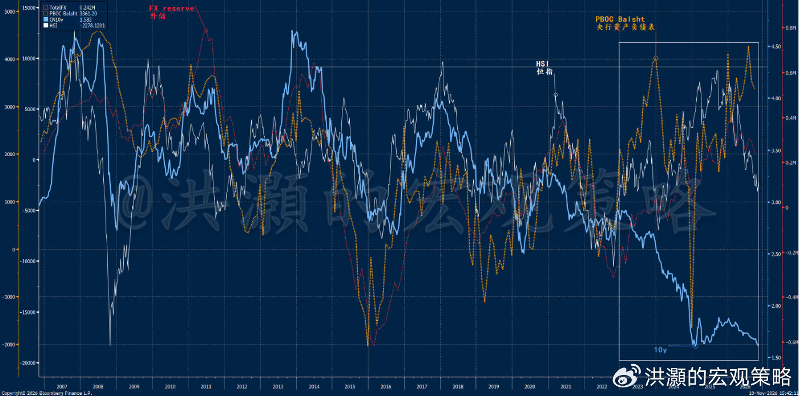

关键数据：2026 年 2 月远期结汇对冲比率仅 14.2%；银行结售汇顺差占海关贸易顺差比例从 2024 年 -11%、2025 年 17% 升至 2026 年前三季度 42%；9 月新签远期结汇 574 亿美元；结汇率从 2024 年 61.6% 升至 2026 年 1—8 月平均 63.8%、9 月 65.3%，仍低于 2013—2017 年约 73% 的均值；境内外币存款从 2024 年底约 8,560 亿美元增至 2025 年底 1.07 万亿美元、2026 年 9 月约 1.2 万亿美元。

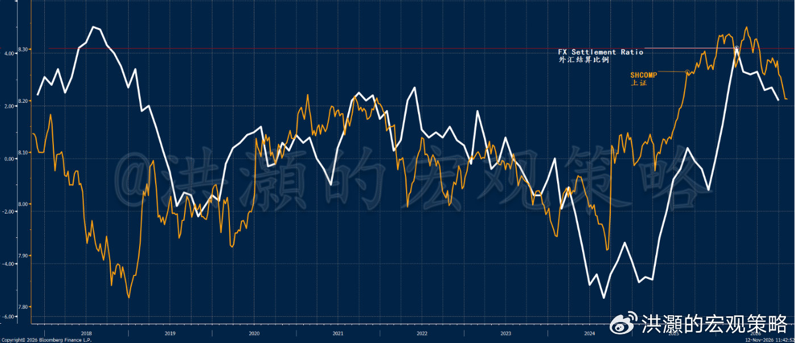

可证伪路径是：结汇率应上升、企业美元存款应下降、人民币升值可能自我强化，亚洲账户海外资产减持应与人民币走强同步。中国经济周期低点约在 2027 年二季度；港股筑底窗口集中在 2026 年 11 月中、12 月中和 2027 年 1 月中。确认信号是人民币升值动量放缓、核心通胀企稳及央行持续扩表。

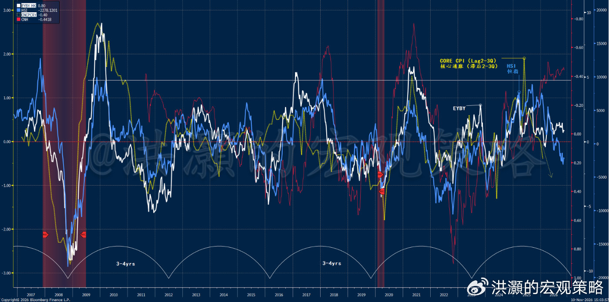

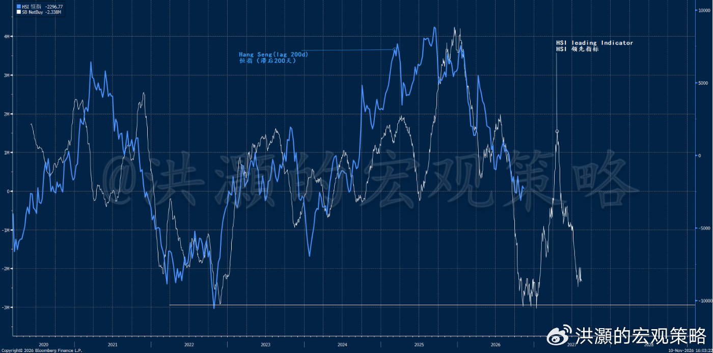

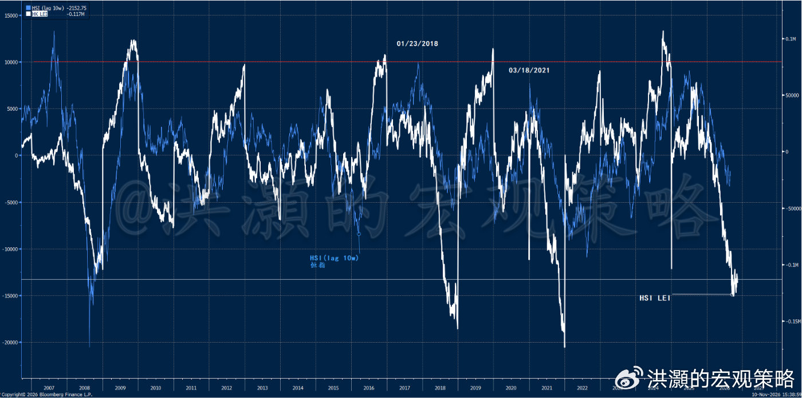

## 六、中国的储蓄过剩与西方的债务危机

中国储蓄过剩、内需不足与美欧日储蓄不足、财政赤字和高资本价格互为镜像。2025 年中国银行对外外币资产增加 2,500 亿美元至 1.39 万亿美元，私人部门对外资本输出 8,080 亿美元，而官方外储变化不大，说明私人部门成为中国顺差融资海外资产的重要渠道。

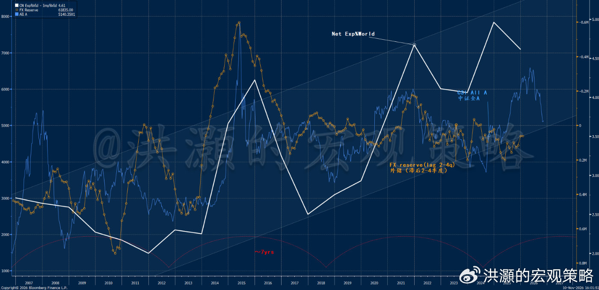

2026 年 1—8 月房地产投资下降 19.2%、固定资产投资下降 7.2%、CPI 约 0.8%—1%、青年失业率约 15%、二季度 GDP 增长 4.3%；人民币从 7.3 以上升至 6.71。PPI 回升主要由成本而非需求推动，回流资金进入债券而非消费，尚不是真正再平衡。

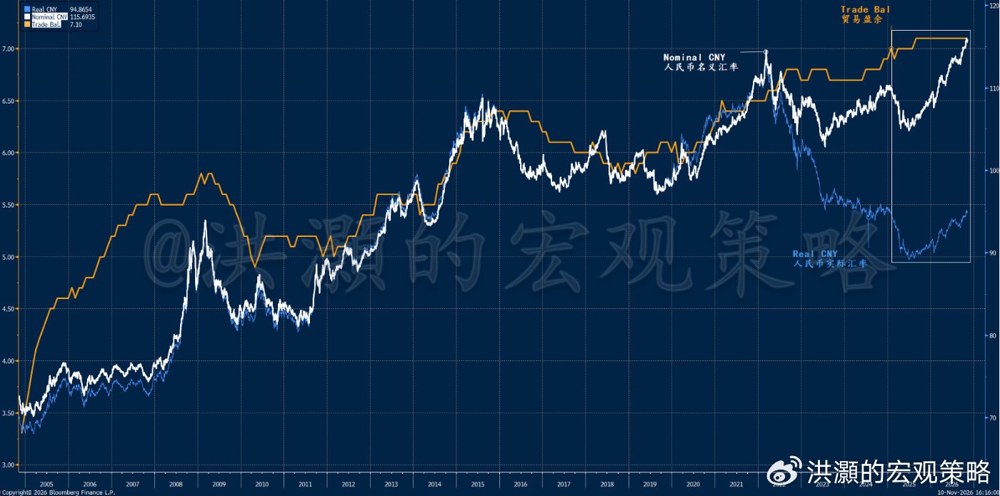

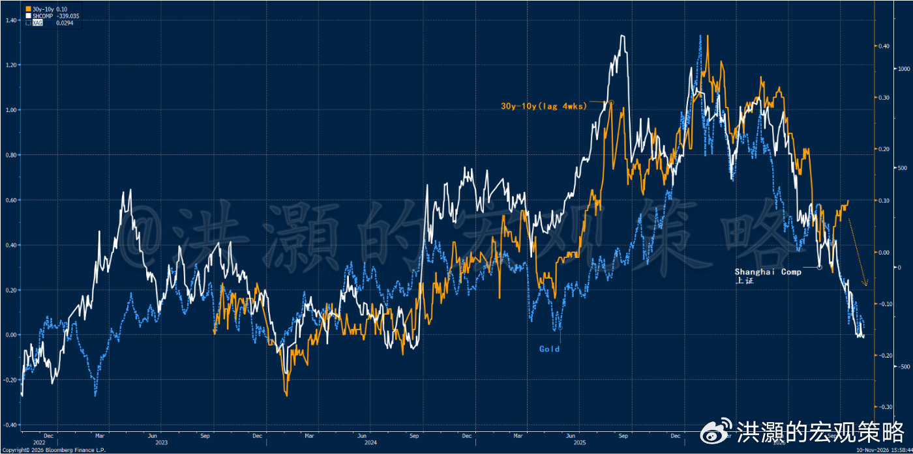

人民币贸易套利逆转与日本资金回流共同减少全球长期资本供给，而西方财政赤字、科技巨头和 NeoCloud 发债争夺资金，使全球长端利率底部可能结构性抬高。中国若以内需承接过剩储蓄，国债收益率会随信贷需求恢复而回升；若继续由汇率承担调整，则意味着更强人民币、持续低收益率和全球风险资产逆风。

## 七、风云际会 2027

2027 年上半年全球流动性继续收缩、企业盈利减速，风险资产出现“领导权真空”；短期情绪指标很低，仍可能有交易性反弹，但不改变宏观压力。

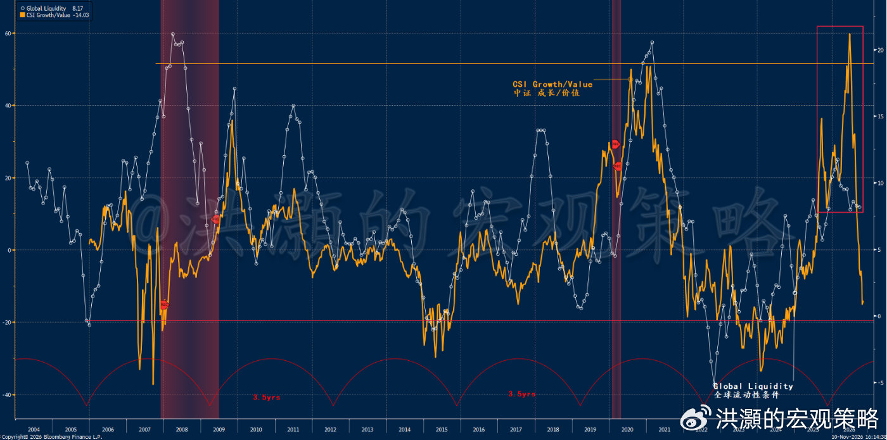

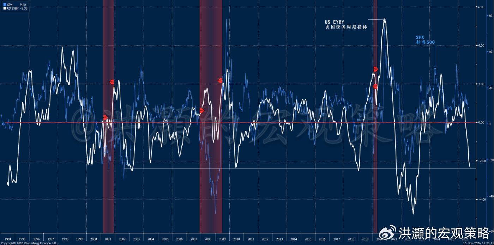

多个周期底部可能在 2027 年下半年附近交汇：中国经济约在年中，全球流动性约在下半年，半导体为 2027 年中至 2028 年初。若同步见底，2027 年下半年可能为 2028 年修复奠基。

确认信号包括：美元见顶与美联储停止加息；人民币升值同比动量放缓；中国央行持续扩表而非短期脉冲；AI 信用压力是否扩散至广泛信用市场。

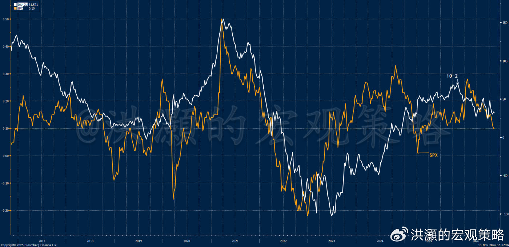

作者最后强调，周期不是闹钟，2027 年应等待多个周期交汇的低点；核心观察是美元何时见顶、人民币升值动量何时消退、中国储蓄最终流向何方。

洪灏，2026.11.12
